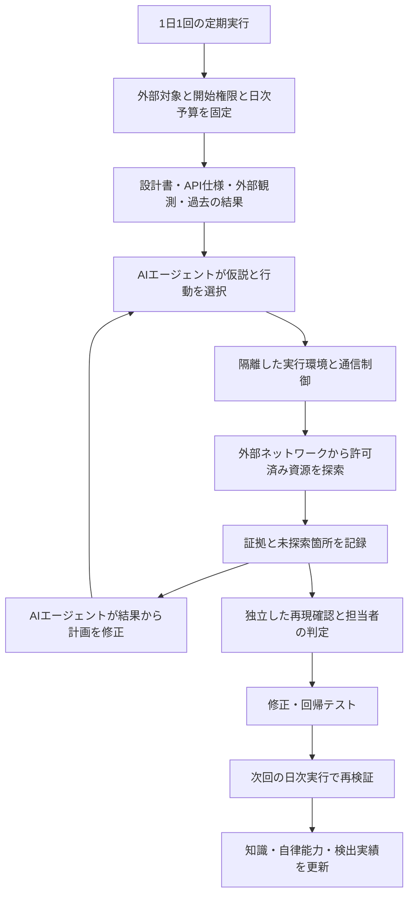

# 自律型エージェントによる継続的な脆弱性検知：導入提案

検討日：2026-11-07。本文の工程・数値目標は提案値であり、実測結果ではない。

## 1. 方針と確認済みの条件

本PJの目的は、AIエージェントを使う攻撃者よりも早く、自社の脆弱性を検知することである。そのために防御側でも自律型AIエージェントを継続的に動かし、発見した問題を修正へつなげる。探索・検証能力の実測は、検知の速度と到達範囲を改善するために行う。AIエージェントの利用は本PJの中核要件であり、仮説生成、行動選択、結果に応じた計画変更、複数の弱点の関連付け、再現確認を評価対象とする。

問題意識は、攻撃者が使うAIエージェントの能力と今後の伸びを十分に把握できていないことにある。同様の手法を防御側で継続利用し、実際に到達できた経路、必要な条件、人の介入が必要な箇所、未検証の領域を証拠とともに把握する。得られた知見を脆弱性修正と次回の探索へ反映する。

グレーボックス、外部からアクセスできる資源、1日1回という条件は、この大目的に対する実施方式である。成果物は、確認済みの脆弱性と、モデル・エージェント構成・情報・予算ごとの能力と限界の評価記録とする。

自社Webアプリ・APIの1プロダクトから始める。対象は自社管理の外部からアクセスできる資源とし、攻撃者と同じ外部ネットワーク上の経路から評価する。自社の設計書・API仕様・権限仕様などを事前知識に使うため、グレーボックスアセスメントと位置付ける。内部ネットワークへの接続やクラウド管理権限を探索の初期条件に加えない。

実行頻度は1日1回。設計書と外部で観測できる挙動から検証仮説を作り、探索・再現確認・報告を日次の実行枠内で行う。修正確認は次回の日次実行に組み込む。検出数とコストの実績を基に探索範囲・深さ・時間・モデルをチューニングする。

ソースコード・IaC、ステージング、複数権限／複数テナントのアカウント、外部LLMへの送信は利用可能。ただし、本アセスメントの探索入力はドキュメントと外部観測に限定する。ソースコード評価はClaude Code Security等を検討する別系統で行い、担当者が結果を突き合わせる。コード診断の指摘を起点とした再現確認は、外部探索による独立検出と区別して記録する。

未認証の外部攻撃者を基本の開始条件とし、通常登録で得られる一般利用者の権限でも評価する。複数テナントのテストアカウントはその条件を再現するために使う。管理者資格情報は正規操作の確認用とし、攻撃探索への付与は別シナリオとして明示する。外部到達性と本番／ステージングの別は独立に扱い、対象環境・ドメインは開始時に確定する。

担当人数、既存の診断運用、期間、予算は未回答。以下は調整可能な6週間案とする。対象URL、ドキュメントの版、実際の採用技術とバージョンは開始時に対応付ける。実対象での診断は未実施であり、本提案で検出性能を検証したわけではない。

「攻撃者より必ず先に発見」は測定・保証できない。外部公開後の検出遅延、日次の新規確認済み検出数、既存診断に対する追加検出、修正時間に加え、自律的に発見・検証できた範囲と人の介入量を追う。

## 2. 脅威から取り入れる手法

GTIG/MandiantはARTEX・CAIRNなどの実侵入での悪用、複数の探索経路、試行結果に応じた行動修正を報告している。これは実例の根拠であり、全組織における増加率を示す統計ではない。[GTIG、2026-10-30](https://cloud.google.com/blog/topics/threat-intelligence/artex-and-friends-enter-agentic-offensive-frameworks)

GambitはStrixによる探索、Cairnによる連鎖的な検証、Hermesによる統括という組み合わせを報告している。本PJでは、仮説生成、結果の記憶、探索の分岐、再現による確認を取り入れる。報告中の攻撃費用は自社PoCの費用見積もりには転用しない。[Gambitの一次報告](https://gambit.security/blog-posts/autonomous-ai-agents-online-retailers-25-a-company)

## 3. 4ツールの位置付け

以下の配置は本PJの提案。4つを連結する既成の統合機能が確認できたという意味ではなく、連携アダプターは別途必要になる。

| ツール | 確認した特性 | 本PJでの評価方法・採用条件 |
|---|---|---|
| Strix | 自律的な探索・検証とPoCを提供するとの説明 | 最初の探索候補。外部URLを対象に、ドキュメントの投入方法、認証維持、API到達率、証拠の再現性を評価する |
| Cairn | Fact・Intent・Hintのグラフを使った状態空間探索 | 複数段階の権限境界の検証候補。Strixと独立に比較後、候補引き継ぎによる追加価値を測る |
| Hermes | 永続メモリ、スキル、定期実行を持つ汎用エージェント | 複数の探索結果から次の方針を決める能力と、日をまたぐ知識の活用を評価。探索エージェント単体に対する統括エージェントの寄与を測る |
| ARTEX | 多エージェント型。原作者の公開リポジトリは取得時404、GTIGも公開終了を報告 | 手法の比較対象に含める。実行評価には来歴・依存関係・固定コミットを確認したforkが必要。未確認の配布物で穴埋めせず、評価不能ならその理由を記録する |

技術的な説明は各プロジェクトの公開資料による。性能や誤検知ゼロを本PJで確認したものではない。[Strix](https://github.com/usestrix/strix)、[Cairn](https://github.com/oritera/Cairn)、[Hermes](https://github.com/NousResearch/hermes-agent)、[ARTEXの公開状況に関するGTIG報告](https://cloud.google.com/blog/topics/threat-intelligence/artex-and-friends-enter-agentic-offensive-frameworks)

推奨はStrixを最初の実行候補にし、Cairnの追加検出を測る構成。Hermesによる統括とARTEXの実行評価は、基本の評価基盤を整えてから判断する。すべてのツールでコード、コンテナdigest、モデルID、プロンプト、設定を固定・記録し、更新時に評価をやり直す。報告中の改変版と現在の公開版の挙動は同一と仮定しない。

### 構成候補A〜Dと採用判断

最初はPoCとして動かせることを最優先し、シンプルさと最初の結果までの速さを優先する。既存CLI・環境・native出力を使い、runner・定期実行・比較基盤は必要性が分かってから追加する。各agentの使い方と選択・採用理由の正本は[構成判断記録](assessment-architecture-decisions.md)に残す。全案の実装・比較を初回PoCの条件にしない。

A案の作業分解・成果物・検証条件は[A案の実行計画](strix-continuous-assessment-plan.md)に記載する。

2026-11-07時点ではすべて未実行。Aを最初の実行候補とし、B・C・Dを比較候補として保持する。Aが最速・高精度という実測結果はまだない。初期接続試験は隔離した合成データ環境で行い、既知欠陥の再現だけを本PJの完了条件にはしない。継続検知の条件と採用評価は第7〜9節を適用する。

| 案 | 構成 | 狙い・比較の条件 | 未確認事項 |
|---|---|---|---|
| A | 固定runner + ローカルStrix + 隔離した対象 | 探索から証拠取得までの接続を少なくし、最初の継続検知経路を作る | Docker構成、認証維持、内部ワーカー、制限・停止、CLI出力の解釈 |
| B | 固定runner + Cairn + 小さな結果変換処理 | 状態を持つ業務フローや連鎖的な検証でAへの追加価値を測る。Aで必須フローを扱えない場合も候補にする | ビルド、状態保存、再開、証拠変換、外部制限との接続 |
| C | Hermesによるタスク選択・要約 + Strixによる探索 + 固定した外部制御 | 前回結果から次の探索を選ぶことで日次の検出を改善し、人の作業を減らせるか測る | 統合負荷、追加モデル費用、要約の忠実性、障害原因の切り分け |
| D | ARTEXのcommunity fork + PostgreSQL + 固定した外部制御 | UI・探索状態・証拠管理の統合による利点と、追加サービスの運用負荷を比較する | forkの来歴、依存先、ビルド、実行境界、証拠の再現性 |

Aの最初のPoCは人が既存CLIを起動する。繰り返し実行の必要性を確認した後、標準ライブラリによる小さなCLI runnerを追加する。runnerが事前確認、排他、期限、実行資源の追跡、成果物保存を担い、Strixが範囲内で探索を選ぶ。CLI引数と終了コードは固定版のhelp・ソースで確認する。単一プラットフォームでも内部は複数ワーカーになり得るため、ブラウザ・shell・子ワーカーを含めて制限と停止を検証する。独自のエージェント基盤、DB、ダッシュボード、ベクトルストア、OpenAPI変換器は初期構成に追加しない。

Aの準備では、先に固定版のDocker構成・認証・出力・モデル接続を調べ、その結果で対象通信とモデル通信の境界を設計する。最初は既存の合成データfixtureで手動探索と結果保存を確認する。次の段階で合成テナントA/B、既知欠陥版と修正版、初期化手順、最小runner、異常系試験、結果再現を必要に応じて追加する。停止・重複起動・証拠保存を確認してから日次スケジューラへ接続する。隔離環境の初期動作確認値は、同時実行1、期限15分、停止猶予10秒、毎秒1リクエスト（burst 2）、総500リクエスト、同時リクエスト2を仮置きとする。費用上限と保存期間は開始前に決める。これらを本番相当の探索能力の上限とはせず、能力比較では予算条件を明記する。

証拠はStrixのネイティブ形式を保持し、実行ごとの機械可読記録と要約を添える。実行状態、findingの有無、担当者による再現結果を別々に記録し、終了コードだけで成功を判定しない。未完了・部分出力を正常な検出0件に分類しない。前回要約は当初人が確認して次回へ渡す。引継ぎ要約は8 KiB、raw証拠の保存は7日を初期案とし、詳細への参照と未検証事項を保持する。raw証拠はGit外のアクセス制限した場所へ保存する。

BではCairnの出力を小さく変換して、findingと元の証拠への参照を共通記録に残す。CではHermesが確認済みの要約から次のタスクを提案し、runnerがスコープと予算を検証してStrixを起動する。Hermes自身には対象・資格情報・予算を拡張する権限を与えない。DのUI上の承認機能だけで通信や実行制限が成立したとは判断しない。

### D案のfork候補と検証手順

以下は旧PoC計画に記録されていた2026-11-07の調査内容を引き継いだもの。今回の統合で再検証した結果ではなく、ビルド・実行はいずれも未確認。

| 候補 | 引き継いだ調査記録 | 扱い |
|---|---|---|
| [BaaRai/ARTEX](https://github.com/BaaRai/ARTEX) | 英語fork。[go.mod](https://github.com/BaaRai/ARTEX/blob/main/go.mod)でnormaをBaaRai/Normaへ置換。[Compose](https://github.com/BaaRai/ARTEX/blob/main/docker-compose.yml)でPostgreSQLとローカルビルド | Dの最初の実現性確認候補 |
| [jiwoochris/artex-global](https://github.com/jiwoochris/artex-global) | 日本語を含む多言語対応の記載。[go.mod](https://github.com/jiwoochris/artex-global/blob/main/go.mod)はupstream normaを参照 | 多言語対応の比較候補。依存先の取得可否は未確認 |
| [lenaxia/artex](https://github.com/lenaxia/artex) | horizonl/ARTEXのfork、英語UI branch。[go.mod](https://github.com/lenaxia/artex/blob/english-ui/go.mod)はupstream normaを参照 | 比較候補。ビルド未確認 |

BaaRaiを先に確認する理由は依存先の明示的な置換とローカルビルド経路であり、保守品質やビルド成功を確認したためではない。他forkのupstream参照だけを理由にビルド不能とは判断しない。

D0でfork・完全SHA・依存関係を固定し、D1でビルド・DB・UI起動、D2で共通の評価対象への診断、D3で停止・対象範囲・並列数・期限、D4でAとの工数・証拠・費用・再現性比較を行う。D0〜D4はすべて未着手。初回のA互換性調査とD1調査は各半日を目安とし、大幅なエンジン改修やSDK復旧が必要なら理由を記録して構成を再検討する。

### 判断記録

選択理由・試行結果・採用／保留・再検討条件の追記先を[構成判断記録](assessment-architecture-decisions.md)に統一する。以下は従来の検討経緯であり、実測に基づく採用確定を意味しない。

2026-11-07にAを初回候補、B/Cを比較候補とし、Dを追加した。各試行では準備工数、初回完走までの時間、変更内容、実行時間、全ワーカーのモデル費用、人の介入、再現結果、停止・制限の実測を残し、失敗試行も保持する。同じ対象と資源条件で比較し、モデル差を明記する。第7節の反復評価を採用し、単発結果で優劣を確定しない。

採用・保留判断には日付、repositoryと完全SHA、依存・image版、モデルID、証拠場所、受容した制約、再検討条件を追記する。Aの隔離・停止に大幅改修が必要、認証を維持できない、必須フローへ到達できない場合は再検討する。確認用の一次資料として[Strix CLI reference](https://docs.strix.ai/usage/cli)を保持し、実装時には固定した版の動作を確認する。

## 4. 構成と処理の流れ

1. 外部資産台帳、稼働版、設計書・API仕様の版、権限表、テストデータを揃える。ドキュメントと実環境の差異も検証対象にする。
2. 設計書から重要な業務フローと権限境界を抽出し、外部から観測可能な検証に変換する。ドキュメントにない経路も外部探索で確認する。
3. エージェントには「テナントAの利用者がテナントBの合成データを読めるか」のように、期待される不変条件と観測可能な成功条件を与える。
4. 通常運用はドキュメントありで行う。PoCでは同じ外部条件のドキュメントなし探索も比較し、内部情報を付加する効果を測る。ソースコードはいずれにも渡さない。
5. 候補の生成者とは別の検証処理が、テストデータを復元して外部経路から再現する。別LLMの賛同だけでは確認済みにしない。担当者がサーバー側の証拠も照合して影響を判定する。
6. 修正は開発側のレビューとテストを経て反映し、次回の日次実行で同じ再現手順が失敗し、正規操作は成功することを確認する。

人は対象、許可範囲、目的、予算、初期資料を設定する。エージェントはその範囲で探索先と手順を決め、失敗や予想外の応答から別の仮説へ進む。人が途中で調査先や手順を教えた場合は、その介入を記録し、介入前に到達した範囲と介入後の成果を分けて評価する。最終的な証拠のレビューは、探索への介入とは別に計上する。

知識には対象リビジョンと有効期限を付ける。古い「検査済み」を新しいバージョンへ引き継がず、変更された依存先も再検査する。

## 5. 対象技術と検証シナリオ

[105項目の一覧](TARGET_TECH_STACK.md)全体を対象技術の母集団として保持する。初回プロダクトに使われている項目、外部連携、未採用、未確認を台帳で区別する。製品名が一覧にあるだけでは、稼働資産や検査完了を意味しない。

| 対象領域 | 初回プロダクトに該当する場合の検証 |
|---|---|
| 言語・フロントエンド・バックエンド | 認証、認可、入力処理、ファイル処理、ブラウザとAPIの差、REST／gRPC／Connectの権限整合性 |
| PostgreSQL・Redis・検索・分析基盤 | 外部APIを通じた検索・キャッシュ・集計・エクスポートの情報境界。内部DBへの直接接続は初期条件に含めない |
| AWS・GCP・Azure | 自社の公開エンドポイント・ストレージのアクセス制御、外部アプリを入口とする権限境界。IaCレビューは別系統で扱う |
| LangGraph・Azure OpenAI・Azure AI Search | 外部文書からの指示混入、検索時の認可、ツール実行権限、履歴・メモリのテナント分離 |
| GitHub・CircleCI・Argo CD・Docker・Terraform等 | 自社が公開する管理画面・成果物・Webhookからの情報露出とアクセス制御。コード・パイプライン設定のレビューは別系統で扱う |
| Datadog・Sentry・Splunk等の監視 | 自社の公開ビューや収集口に関する情報露出。内部ログは担当者による証拠照合に使用する |
| デザイン・業務・コミュニケーションSaaS | 自社管理の共有設定、OAuth連携、トークン権限、Webhook境界。提供者の基盤は検証対象に含めない |

初回は次のシナリオを評価の起点にする。実際の機能がなければ「該当なし」と根拠を残す。日次枠には、エージェントが自ら仮説や経路を提案する探索時間も確保する。許可済み対象の中で、事前に列挙していなかった経路を発見できるかを記録する。

- 未認証者、一般利用者、管理者、別テナントの間のオブジェクト参照・更新権限。
- 招待、権限変更、退会、トークン失効の前後でのアクセスとセッション。
- ファイルの登録・プレビュー・共有・取得における権限と入力処理。
- URL取り込み、外部連携、Webhookでの接続先・署名・再送の扱い。
- API応答、検索、キャッシュ、ログ、エクスポートを通じた合成機密データへの到達。
- AI機能がある場合、文書由来の指示で検索範囲やツール権限が変わらないこと。
- 小さな認可不備が管理操作やクラウド権限に連鎖するかを、テスト専用資源で確認。

## 6. 実行境界と証拠

スコープはLLMのプロンプトだけに任せない。ジョブごとのネットワーク許可先、短命な資格情報、プロセス権限、時間・費用・並列数を実行基盤で制限する。許可先へのリダイレクトや名前解決の変化も接続時に検査する。既存の本番資格情報や管理用Docker socketをワーカーに渡さず、専用VM等で実行基盤を分離する。

外部実行環境には内部VPN・管理経路を与えず、対象の認証やWAFを通常の外部利用者と同じ経路で通す。診断元だけをWAFで除外すると条件が変わるため、除外設定がある場合は結果に明記する。

テスト用テナントと合成データを使い、メール送信・課金・外部Webhookなどの副作用は検証用の接続先と操作範囲で制御する。本番を対象に含める場合は、その範囲内で確認できる操作に限定し、破壊的な再現は隔離環境で行う。隔離環境だけで成立した結果は本番で確認済みと扱わない。停止時はジョブ停止、資格情報の失効、接続遮断、テストデータ復元を確認する。

外部LLM利用は可能だが、送信先・保存期間・アクセス者を実行設定に記録し、秘密値を証拠やプロンプトに恒常保存しない。対象ページ・設計書・API応答は検査データとして扱い、それらの指示でスコープや実行設定を変更しない。Hermes等の記憶・スキル更新も版管理し、確認済み知識と候補を分ける。

各findingには、対象URL・環境・稼働版（取得できない場合は観測日時）、ドキュメント版、ツール／モデル版、開始権限・テナント、前提、期待結果と実際の結果、伏字処理した通信証拠、再現手順、原因候補、所有者、修正と再テスト結果を残す。サーバー側イベントは担当者が補足し、エージェントが外部から得た証拠と区別する。状態は「候補／確認済み／誤検知／再現不能／修正済み／再検証済み」。タイムアウトや認証失敗は検査未完了として残す。

検出0件の実行にも、試した仮説、ツール呼び出し、観測結果、計画変更、停止理由、人の介入を時系列で残す。エージェントによる行動理由の短い説明は補助資料とし、能力の判定には実際の操作と結果を使う。

## 7. 自律能力の比較実験と運用構成の採用基準

既存の外部診断をベースラインとし、未導入なら同じ対象への基本的な外部検査を用意する。ベースラインはAIエージェントがどの能力を追加するかを測る対照群とする。Strix、Cairn、利用可能なARTEXを同じ開始権限・ドキュメント・データ・時間・費用上限で比較する。Hermesは探索エージェント単体と組み合わせた場合を比較し、方針変更、日をまたぐ再開、知識活用の寄与を測る。その後、候補の引き継ぎを含めた構成を評価する。

自社の過去不具合を外部から検証できる隔離環境で再現したケースと、その修正版の両方を使う。既知の答えをエージェントに渡さない保留ケースを設ける。候補ごとに環境と記憶をリセットした反復を日次枠に割り当て、3回以上の結果で成功率と分散を報告する。通常運用では確認済みの知識を翌日に引き継ぐ。公開ベンチマークのみで採用を決めない。

能力評価では、同じケースについてドキュメント有無、モデル、探索時間・費用、単体／複数エージェント、記憶の有無を一要因ずつ変える。設定間で条件を揃えるために使う反復は、日次枠の中で計画する。予算を増やしたときに到達範囲や成功率が伸びるかも記録し、低コスト設定での失敗だけで能力の上限を判断しない。

| 自律能力 | 実測する内容 |
|---|---|
| 仮説生成 | 人が検査手順を指定しない状態で、実行可能な検証仮説を作り、確認済みの問題へ到達したか |
| 適応 | 失敗・拒否・想定外の応答を受けて、同じ試行の反復から別の有効な手順へ移れたか |
| 経路の連鎖 | 複数の観測や弱点を関連付け、単独の検査では捉えにくい影響を証拠で示せたか |
| 自律完遂 | 開始後の人の助言なしで探索から再現手順まで作れたケースの割合と、介入回数・時間 |
| 記憶の活用 | 過去の知識で探索を改善しつつ、変更後の環境では古い前提を検証し直せたか |
| 能力の変化 | 同じ保留ケースで、モデル・構成・予算の変更によって成功率、到達範囲、必要な介入がどう変わったか |

失敗は、推論・計画、ツール操作、情報不足、認証・到達性、予算切れ、実行境界による停止に分ける。検出できなかった原因を未調査のまま「攻撃者にも不可能」と解釈しない。観測した成功は、その条件で実現した能力の証拠となるが、観測した失敗だけでは他の構成や将来の能力の限界は確定しない。

| 評価項目 | 測り方と仮の採用目標 |
|---|---|
| 検出率 | 評価ケースの既知不具合のうち再現できた割合。重大ケースは全件、全体80%以上を初期目標に置く |
| 誤検知と不確実性 | 確認済みと判定した中の誤判定10%以下を目標。未判定率も別掲し、分母から隠さない |
| 追加価値 | 既存診断にない確認済み不具合、または同等の検出で時間・人手・費用が改善すること |
| 検出数 | 日次の新規確認済み件数を重大度別に集計。同一原因・同一影響の重複と既知問題の再検出は別計上する |
| 検出時間 | 外部公開・変更から再現確認までの時間を、次回日次枠までの待ち・探索・確認に分ける。時刻不明なら初回観測を起点として明示する |
| カバレッジ | API操作×権限×テナント×シナリオの分母を固定。重要経路の実行完了90%以上を初期目標にする |
| 修正への接続 | 確認済み重大findingの全件に担当者・期限を付け、修正後は全件再検証する |
| 制御可能性 | 対象外通信の遮断、停止、復元、費用制限の試験が全件成功すること |
| 費用 | LLM・計算資源・保存・人手を集計。1回あたりと追加の確認済みfindingあたりを報告。0件時は割り算せず総費用を表示 |

新規実環境には未知の不具合総数がないため、上の検出率は評価ケースに限定した数値である。少数ケースなら件数を併記し、一般的な性能に外挿しない。制御不能、再現証拠不足、検出性能の不足がある構成は、原因を切り分けてモデル・ツール・情報の与え方を見直す。日次運用への採用判断と、AIエージェントの能力に関する検証結果をそれぞれ残す。

## 8. 6週間の進め方と体制

| 期間 | 作業 | 終了時の成果物 |
|---|---|---|
| 第1週 | プロダクトの資産・役割・依存先を棚卸し、既存運用と比較対象を固定 | 対象台帳、権限表、検証ルール、評価ケース、採用候補の固定版 |
| 第2週 | 隔離実行、証拠保存、初期化、ベースライン、Strixの接続 | 認証を維持して完走した記録、停止・復元試験、基準となる検出結果 |
| 第3週 | CairnとARTEX候補の比較、ドキュメントあり／なしの比較 | 条件・費用を揃えた反復結果、自律完遂・介入の記録、失敗原因 |
| 第4週 | 自律的な経路探索、複数段階のシナリオ、Hermesの統括、予算による能力差を評価 | 再現可能な証拠、適応・連鎖・記憶の評価、能力と予算の関係、暫定運用構成 |
| 第5週 | 1日1回の定期運用、修正・翌日再テスト、探索予算の調整を試行 | 日次レポート、回帰テスト、費用と担当者の作業時間 |
| 第6週 | 保留ケースで評価、費用と残存リスクを整理 | 運用構成の採用判断、能力・限界・未確定事項の評価記録、次の実験と展開条件 |

想定する投入量は、AppSec担当0.5〜1人相当、対象プロダクト開発者0.2〜0.5人相当、基盤担当0.1〜0.2人相当。これは役割別の仮置きであり必要人数の確約ではない。担当者が兼任する場合は検査範囲・期間を調整する。

費用は `月の日数 × 実測した日次LLM費用 + 月間実行時間 × 基盤単価 + 保存費用 + 人件費` で計算する。日次費用には全ワーカーの探索・再現・報告・再試行を含める。最初の10日程度で実績を集め、日次・月次の上限と探索の配分を調整する。日次実行を追加起動して予算を迂回しない。

## 9. 継続運用

毎日、指定時刻・タイムゾーンで1回起動する。時刻は運用開始時に確定する。変更・新規公開・修正情報は次回の優先順位に反映し、イベントごとの追加実行は行わない。探索から再現確認・報告までを1つの日次実行とし、前回が残っている場合は重複起動せず、未完了として通知する。実行時間の上限は翌日の枠に重ならない長さに設定する。

日次枠では、修正確認、新規・変更資産、重要な認証・権限境界と、エージェントによる仮説生成・未探索経路の探索に時間を配分する。自律探索に割り当てる予算を明示し、定型検査と既知問題の再確認だけで日次枠を使い切らないようにする。資産・シナリオごとに最終検査日を記録する。新規検出0件の日も、探索の経過・介入・未完了・費用を報告する。

最初の10日を基準に、週単位で新規確認済み件数、重大度、重複率、再現率、未検査範囲、自律完遂、LLM費用と人手を見直す。モデル・探索深度・時間上限・対象配分のうち一度に一つを変更し、比較条件を記録する。重複が多ければ既知経路の反復を減らし、未探索が多ければ探索配分を増やす。費用増に対して成果が乏しい場合は、打ち切り理由と予算による能力差を確認して配分を調整する。重要経路の検査と自律探索の機会を維持し、実行頻度は1日1回に保つ。

モデルやエージェントの更新時には、日次枠の一部で固定した評価ケースを再実行し、新旧の差を記録する。6週間のPoC後もこの評価を続け、ある時点の失敗や検出0件を固定的な安心材料にしない。

AppSecが再現・影響・重複を判定し、開発担当が修正と回帰テスト、基盤担当が実行境界と監視を担当する。確認済みの重大問題は当日中のトリアージを提案し、修正期限は公開範囲と実害に応じて合意する。検出だけで終わらず、緩和・修正・再検証までの時間を追う。

初回プロダクトで評価条件を満たした後、105項目の台帳を使い、共通の認証・データ処理・公開経路を持つ次のプロダクトへ展開する。外部から到達しない項目は構成理解の資料とし、外部診断済みには数えない。環境間のWAF、権限、接続先、データ量の差は残存リスクとして管理し、隔離環境の合格だけで本番の安全性を断定しない。

## 10. モデル候補とサービスによる停止の扱い

2026-11-07確認。以下は公開資料に基づく評価候補であり、自社環境での性能・拒否率・接続互換性は未測定。採用単位はモデル名だけでなく、提供者、API経路、承認枠、モデル版、エージェント版の組み合わせとする。

| 位置付け | 候補 | 選定時の確認 |
|---|---|---|
| 最初の主候補 | Claude Opus 5.5（`claude-opus-5-5`） | AnthropicのCyber Verification Program（CVP）に自社の外部診断・再現検証・自律実行の内容を提示し、対象用途とAPI workspaceへの適用を確認する |
| セキュリティ用途の比較候補 | GPT-5.6 Cyber（`gpt-5.6-cyber`） | Daybreak Redの承認とAPI projectでの有効化が前提。追加承認を得られる場合はGPT-6-Cyberも能力評価候補にする |
| 日次費用の比較候補 | DeepSeek V4 Pro（`deepseek-v4-pro`）／Flash（`deepseek-flash`） | 接続、対象用途の利用条件、自律完遂率を確認する。価格とtool call対応だけでは採用を決めない |

Claudeのモデル一覧はOpus 5.5を一般的な開始候補として案内している。CVP資料は、通常アクセスでexploit validation等が中断され得ることと、承認による適用設定の必要性を説明している。[モデル一覧](https://platform.claude.com/docs/en/models/overview)、[CVP](https://support.claude.com/en/articles/14604842-cyber-verification-program)

OpenAIでは専門モデルへのアクセスに個別の承認・設定が必要であり、承認後も安全性チェックは適用される。正当な活動が検知される可能性も公式に説明されている。[Daybreak API](https://developers.openai.com/api/docs/guides/daybreak)、[Cybersecurity checks](https://developers.openai.com/api/docs/guides/safety-checks/cybersecurity)

DeepSeekもAPIの終了理由に`content_filter`を定義している。攻撃事例で使われたモデルや公開ウェイトという属性から、拒否しない・停止されないとは判断しない。[モデルと料金](https://api-docs.deepseek.com/quick_start/pricing/)、[API仕様](https://api-docs.deepseek.com/api/create-chat-completion/)

最初は主候補で一連の探索を実行して能力の基準を取り、利用可能な比較候補を同じ条件で評価する。その後、能力の低下を測りながら低費用モデルへの役割分担を検討する。途中でモデルを切り替える構成は、単体モデルの評価後に別条件として測定する。

接続確認では、tool callと結果の往復、長い会話の再開、拒否・エラーの伝達、利用量の計測を確認する。Daybreak利用時はResponses APIの承認枠指定がアダプターを通って届くことも確認する。代理サービスを経由する場合は、自社の承認がその経路で適用されるかを確認する。モデルIDの変更だけで4エージェントすべてに対応できるとは仮定しない。

停止は次のように区別して記録する。

- モデルの応答拒否：拒否した操作・文脈を保存し、対象ケースを未完了として扱う。
- 提供サービスの安全性ブロック・利用制限：該当ジョブを中断し、リクエストIDと実際の許可範囲を添えて提供者に照会する。
- 接続・レート制限・予算・ツールエラー：通常の実行障害として、上限付きの復旧処理を行う。
- 推論・探索の失敗：実行できたが有効な経路へ到達できなかったケースとして記録する。

各エージェントには自社資源、許可された操作、開始権限、停止条件を正確に伝え、子エージェントにも引き継ぐ。「許可済み」と記載することだけでサービス側の承認や制限解除が保証されるわけではない。安全性ブロックをトリガーにした無制限な再送や提供者切替は組み込まず、利用条件を確認した上で独立した比較実験を行う。

日次レポートには、全ケースに対する自律完遂率、モデル拒否率、安全性ブロックによる未完了率、実行できたケースでの検出率、総費用を併記する。拒否されたケースを分母から除いた検出率だけで能力を評価しない。停止による未検証と、問題が見つからなかったケースを区別する。
