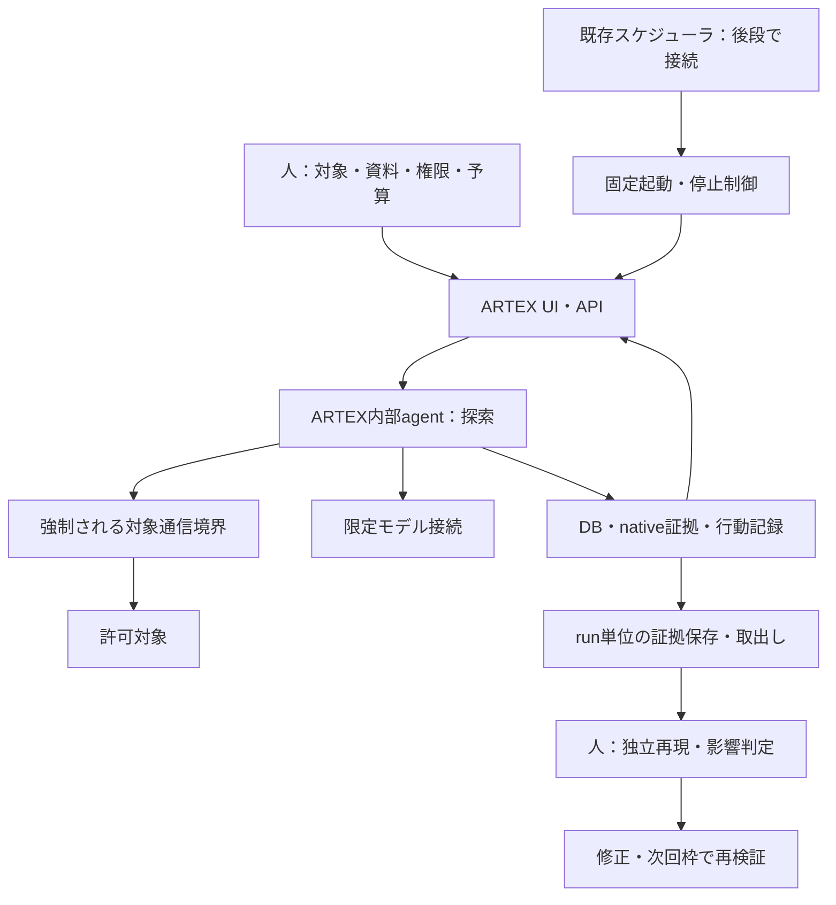

# D案：ARTEXによる継続的な脆弱性検知の実行計画

作成日：2026-11-07。状態：計画案。ビルド・実装・診断・日次運用はすべて未着手。

本書は[導入提案](agentic-security-plan.md)のD案を、[A案](strix-continuous-assessment-plan.md)・[B案](cairn-continuous-assessment-plan.md)・[C案](hermes-continuous-assessment-plan.md)と同じ段階・粒度で具体化する。目的、対象、開始権限、日次頻度、採用基準は導入提案を正とする。ABCDの選択理由は[構成判断記録](assessment-architecture-decisions.md)へ記録する。成果物名・操作・工数は実装案であり、機能の動作保証ではない。

## 1. 目的と到達点

目的は、AIエージェントを使う攻撃者より早く、自社の脆弱性を検知すること。DではARTEXの内部agentが設計書と外部観測から探索し、統合UIと保存機能で証拠・状態を確認して、独立再現・修正・再検証へつなげる。検出能力に加え、証拠整理や日次レビューの自作・手作業をどれだけ減らせるかを測る。

攻撃者の発見時刻は通常観測できないため、公開・変更から確認済みfindingまでの時間を優先指標とする。時刻不明なら初回観測を起点と明記する。UIの表示件数や完了表示、検出0件だけで検査完了や安全性を判定しない。

**最優先は、シンプルなPoCを短時間で動かして実結果を得ること。** 最初は既存のUI・起動経路で1対象を手動診断し、証拠の保存・取り出し・停止を確認する。独自runner、外部DBの追加、独自UI、全forkの比較は初回起動の条件にしない。ARTEXに必要なDBと実行環境は最小構成に含む。

| 段階 | 完了条件 | 現在の扱い |
|---|---|---|
| P：初回PoC | 固定forkのDB・UI・モデルが接続し、限定対象を探索。領域別結果・証拠を保存し全agent停止を確認 | Dを試す最初の到達点 |
| M2：反復と自動化 | 必要な起動接続、結果取得、異常系、保存復元、比較評価を追加 | Pの不足から選択 |
| M3：日次試行 | 1日1枠の検知、レビュー、修正再検証を運用 | 手動試行が有効な場合に進む |
| M4：採用判断 | 検知と証拠管理の価値、追加サービスの負担から継続・改善・保留を判断 | 日次の実測で判断 |

ビルド成功、起動成功、検査範囲、検出の有効性、運用への採用は別判定とする。主要領域の未確認を残したまま侵害可能性の評価完了としない。欠陥版・修正版の反復や10日次枠の観測は初回条件に含めない。

### 最初に実行する作業：P0〜P4

他文書からはD-P0等と識別する。全項目未着手。専用host・モデルアクセス・合成fixtureが利用可能なら初回結果まで半日〜1日を目標にする。ただしビルド可否は未確認で、P1で半日を超える復旧が必要ならいったん調査結果を残して構成判断へ戻る。

| ID | 作業 | 成果物・完了条件 | 目安 |
|---|---|---|---|
| P0 | fork候補、対象1つ、許可操作、開始権限、代表モデル、入力・主要領域・予算を決定 | 実行メモ、領域表、fork選択理由、合成アカウント参照、保存・復元先 | 30分を目安に着手 |
| P1 | forkと依存を固定し、ビルド・DB・UI・認証・モデル接続・結果取得経路を確認 | 完全SHA、依存版、image識別子、実操作、ビルド結果・未対応一覧 | 1時間〜半日を目安に調査 |
| P2 | 対象通信境界、管理UI・DB到達範囲、期限、全agent・子プロセス停止を確認 | 対象到達と対象外遮断、停止後の通信なし、再起動時の扱い | 1〜2時間 |
| P3 | 既存UI等で1タスクを手動起動し、主要領域を探索。結果・通信証拠を保存 | native結果、領域別試行、証拠参照、終了状態、時間・費用・介入 | 対象規模と日次枠から設定 |
| P4 | UI表示と原証拠を照合し、候補を独立再現。A等と比較できる実績を整理 | 確認済み・誤判定・未判定、未確認範囲、レビュー工数、D継続理由 | 結果量に応じて設定 |

P0→P1→P2→P3→P4の順に進める。初回の結果転記は手動でよく、既存APIの自動連携を待たない。合成データ、対象限定、期限と停止は起動前に確定する。初回を含む診断は1日1回の枠・総予算へ計上し、他案と試す場合も追加枠を作らない。

導入提案の既存D0〜D4との対応は、D0＝P0〜P1のfork・依存固定、D1＝P1のビルド・起動、D2＝P3の探索、D3＝P2および後段の制御試験、D4＝P4および後段の比較とする。対象通信・停止の最小確認はD2の診断前に実施する。後述D00〜D12は自動化後の作業IDである。

### 代表的なモデル・入力と結果の見方

利用可能で固定版ARTEXと互換性のあるセキュリティ用途のClaudeモデルを第一候補とする。接続先、提供者、正確なモデルIDを固定し、アクセス権・互換性をP1で確認する。複数の内部agentが使うモデルを確認し、別モデルがある場合も記録する。開始前の代替選択は理由を残す。

| 入力 | 内容 | agentに期待する使い方 |
|---|---|---|
| 権限・禁止条件 | 役割・テナントごとの可否、不変条件 | 正規操作と越権操作を比較する |
| API仕様・業務フロー | 既存API説明、画面との対応、招待・変更・退会等の状態遷移 | 単体APIと複数操作の経路を探索する |
| 合成データ・アカウント | 未認証、一般権限、別テナント、初期状態・復元 | 権限・状態を変えて比較し、同じ条件で再現できるようにする |
| 検査手順 | WSTG、OWASP API Security Top 10、必要なASVS・選択したSkill手順 | 対象の主要領域を広く扱い、証拠・未確認理由を記録する |

手順候補は導入提案のOWASP Secure Agent Playbook、Anthropic Cybersecurity Skills等から対象に合う内容を選び、版と投入範囲を残す。後者はコミュニティ製である。ARTEXへの資料投入・Skill認識は固定版で確認し、対応を仮定しない。既存資料を優先し、不足は短い実行メモで補う。

探索入力はドキュメントと外部観測とし、ソースコード・IaC・既知欠陥の正解を混ぜない。開始条件は未認証と通常登録相当の一般利用者を基本に、別テナントの合成アカウントを用意する。管理者資格情報は正規操作確認用とし、攻撃探索への利用は別シナリオにする。秘密値を報告や共有ログに保存しない。

情報収集・公開設定、認証・セッション、認可・テナント分離、入力・ファイル処理、業務フロー・状態遷移、クライアント側処理を領域表へ並べ、外部連携・公開クラウド・AI機能も該当すれば追加する。各領域は「確認して証拠あり／該当なしと根拠あり／未確認と理由・次の検査」とする。UI上のcoverage表示と、この表の対象経路・権限・テナント・シナリオを照合する。

画面表示や自動報告だけで全領域を検査済みとせず、実際の操作と証拠に遡る。0件の場合も探索経路・認証・未確認・停止理由を見る。モデル・入力の全組合せを比較することへ時間を使わず、結果から必要な一要因だけ追加検証する。

## 2. 構成と責任分担

2026-11-07確認のBaaRai/ARTEX READMEは、統合UI、task・finding・通信記録、PostgreSQLを使う構成を説明している。本PJの起動・検出性能は未検証である。[BaaRai/ARTEX README](https://github.com/BaaRai/ARTEX)

公開ComposeにはARTEXのローカルビルド、PostgreSQL、永続volumeとdata・keys・skillsのマウント、再起動設定がある。管理UIの初期bindはloopbackだが、固定版の実効設定をP1で確認する。[Compose](https://github.com/BaaRai/ARTEX/blob/main/docker-compose.yml)

公開go.modはnorma依存をBaaRai/Normaへ置換している。依存取得・ビルド成功の証拠ではないため、P1で実際の取得可否と固定版を記録する。[go.mod](https://github.com/BaaRai/ARTEX/blob/main/go.mod)

| fork候補 | 本計画の扱い | 選択・変更の判断 |
|---|---|---|
| BaaRai/ARTEX | 最初の実現性確認候補 | 明示的な依存置換とローカルビルド経路を確認できるため。保守品質・検出性能の評価は未実施 |
| jiwoochris/artex-global | 導入提案にある多言語候補として保持 | 必須操作・資料表示で言語上の障害が出た場合に調査。今回のビルド確認なし |
| lenaxia/artex | 導入提案にある英語UI候補として保持 | 最初の候補で実現できない具体的理由が出た場合に再検討。今回のビルド確認なし |

候補切替時は理由・未解決点・依存差・再検証項目を構成判断記録へ追記する。既存データの互換性を仮定して別forkへ移さない。報告にある改変版と公開forkの挙動を同一と扱わない。

| 担当 | 責任 | 事前確定事項 |
|---|---|---|
| AppSec | 領域・task設定、候補確認、日次レビュー、採用 | 主担当・不在時担当、重大候補の当日確認 |
| 開発 | 資料、合成データ、初期化、サーバー証拠、修正 | revision、正常操作、復元・修正担当 |
| 基盤 | ビルド、DB・UI管理、通信・停止、backup、日次起動 | 専用host、公開範囲、モデル・管理認証、保存・復元手順 |
| ARTEX | 許可範囲内の仮説・探索・証拠記録 | 全内部agentに適用する開始条件と上限 |
| 外部制御・結果取得 | 契約検証、排他、期限、資源回収、共通記録 | UI表示と独立した停止・観測経路 |

必要なARTEX・DB・専用環境とnative保存から開始する。独自ダッシュボードや証拠DBは追加しない。採用fork完全SHA、Go・Node等の実際のbuild tool、依存、base・DB image digest、ローカルbuild image ID、モデル・Skill版を固定する。[105項目の台帳](TARGET_TECH_STACK.md)と実採用を対応付け、対象を一度に広げない。

## 3. PoC後の拡張時に決める事項

初回の必要値はP0〜P2で確定する。以下は該当する拡張前に詳細化し、すべてを初回条件へ繰り上げない。

| 項目 | 必要情報 | 担当・期限 |
|---|---|---|
| 対象・権限 | origin、環境、許可先・除外、操作、役割・テナント | AppSec・開発／D00 |
| fork・依存 | 完全SHA、build tool・image、依存取得、更新方式 | 基盤／D01 |
| 管理経路 | UI・API・DB・proxyの到達元、初期設定、認証 | 基盤／D02 |
| fixture | 欠陥版・修正版、合成アカウント、正常操作、reset | 開発・AppSec／D03 |
| 自動化経路 | task作成・状態取得・停止・exportの実在する操作 | 基盤／D01、D05 |
| 保存・復元 | DBとdata・keys・skillsの関係、証拠取出し、保持・削除 | 基盤・AppSec／D07 |
| 予算 | 全agentの日次・月次費用、時間・通信・並列数 | 責任者・基盤／D00、D09 |
| 日次 | 時刻・timezone、確認者、欠測連絡、再起動時のtask扱い | 基盤・AppSec／D10 |

## 4. PoC後の作業候補

全項目 `NOT STARTED`。PoCや他案のfixture・境界設計を再利用できるが、ARTEXの内部agent・通信・保存・停止は固定版で検証する。工数は仮置きで外部待ち・日次観測日数は別とする。

| ID | 作業・成果物 | 依存 | 担当 | 目安 | 完了条件 |
|---|---|---|---|---|---|
| D00 | 実行契約、領域表、対象台帳、fork選択理由 | なし | AppSec・開発・基盤 | 0.5〜1日 | 対象・開始権限・上限・保存先を特定 |
| D01 | fork・依存・build・UI/API・モデル・exportを調査 | D00 | 基盤・AppSec | 初回0.5日 | 固定版一覧、build結果、capability表、未対応を記録 |
| D02 | 管理・対象・モデル・DB経路と停止を設計 | D01 | 基盤 | 0.5〜1日 | UI承認に依存しない通信境界と全agent停止の方式を決定 |
| D03 | 欠陥版・修正版、合成アカウント、資料とresetを用意 | D00 | 開発・AppSec | 1〜2日 | 人が欠陥を再現し修正版で拒否、正常操作成功。正解を分離 |
| D04 | 固定buildとDB・UIを専用環境で起動し手動試験 | D02、D03 | 基盤・AppSec | 1〜2日 | モデルtool往復、証拠取出し、対象外遮断、全agent停止を確認 |
| D05 | 必要最小限のtask起動・状態取得・排他・記録を接続 | D04 | 基盤 | 1〜2日 | 不足入力と重複を拒否。runとtaskを照合しnative証拠を保持 |
| D06 | deadline、外部停止、残存task・process、再起動回復を実装 | D05 | 基盤 | 1〜2日 | 第6節の異常系合格。停止後の通信・勝手なtask再開なし |
| D07 | finding対応、証拠export、伏字、backup・復元を整備 | D05 | AppSec・基盤 | 1〜2日 | 共通記録と原証拠が一致。隔離復元先でtaskと証拠へ遡れる |
| D08 | 欠陥・修正版各3回以上の反復とベースライン比較 | D06、D07 | AppSec・開発 | 準備1日＋日次枠 | 失敗を含む分母、再現率、工数、費用を記録。M2判定 |
| D09 | 自社1プロダクトの外部経路・資料・認証へ適用 | D08 | 全担当 | 1〜2日 | 実対象契約と通常経路での手動探索・証拠確認が成立 |
| D10 | 既存スケジューラへ接続し日次確認と欠測検知 | D09 | 基盤・AppSec | 0.5〜1日 | 1日1枠、重複拒否、起動欠測・失敗を把握 |
| D11 | 10日次枠で探索・独立確認・修正・再検証 | D10 | AppSec・開発 | 10日次枠＋確認 | 全予定枠、0件日、未確認・介入・費用を記録 |
| D12 | 検出と管理負担の改善から継続・改善・保留を判断 | D11 | AppSec・責任者 | 0.5〜1日 | 採用理由、fork依存の制約、運用工数、再判断条件を記録 |

D01の半日調査で依存復旧や大幅な改修が必要なら、長期のfork保守へ自動的に移行しない。失敗箇所と代替候補を構成判断へ戻す。D03とD01〜D02、D06とD07は依存充足後に分担可能だが、担当と共有環境の競合を確認する。

## 5. 自動化へ進む場合の起動制御と保存データ案

連携コードは `src/assessment_runner/`、テストは `tests/assessment_runner/`、非秘密fixtureは `assets/assessment-fixtures/`。既存の共通処理を再利用し、ARTEXのtask操作・状態・exportに必要な部分だけ追加する。最初のコード追加時にREADME、実際の版、formatter/linter、確認済みのsetup・run・test手順を記載する。

候補操作は `preflight / run / stop / summarize`。UI/APIに存在する操作をD01で確認して固定し、未確認APIを前提に実装しない。自動起動・停止・結果取得が成立しなければ日次自動化を保留し、手動試行の成果を残す。初回に汎用の画面操作自動化を追加しない。

| 記録 | 必須情報 |
|---|---|
| 実行契約 | schema版、対象・revision、資料、開始権限、許可操作、fork・依存・model版、時間・費用・通信上限、保存先 |
| run | run ID、ARTEX task ID、日次枠、UTC時刻、契約、元の終了情報、native状態、共通状態、停止理由、全agent集計 |
| finding | native ID、対象・権限・テナント、期待／実際、通信証拠、再現手順、独立判定、重大度、重複、担当・期限、修正履歴 |
| 証拠 | 原保存先とexport、task・finding参照、取得時刻、伏字有無、欠落・打切りの有無、整合性確認結果 |
| 日次要約 | 変更、実際の探索、確認済み・候補、未確認、介入、費用、次回候補 |
| 復元記録 | DBと関連ファイルのsnapshot、版・取得時刻、復元先、整合性、確認した証拠、保持・削除の対象 |
| 評価 | ケース、評価者のみの正解、reset、反復、条件、検出と再現、ベースライン差、管理作業時間 |

実行状態は `COMPLETED / FAILED / TIMED_OUT / CANCELLED / BLOCKED`、診断状態は `FINDINGS / NO_FINDINGS_REPORTED / INCOMPLETE`。UIの完了表示、API応答、実際のworker終了、証拠の存在を照合する。未確認・認証失敗・欠落出力があれば未完了とし、候補は保持する。native findingを人の独立確認なしに確認済みへ昇格しない。

共有用は伏字処理し、raw証拠はGit外のアクセス制限されたrun保存先へ取り出す。DBに残る原証拠、data、backup、taskログも保持対象に含める。初期案7日、調査中は保持する。run単位の削除が他taskへ影響しない方法をD07で確認する。DB全消去を通常のrun cleanupに使わない。

backupはDBだけで十分と仮定せず、証拠ファイル・鍵・Skill設定の依存を調べる。必要な秘密情報は別の保護された保存先へ置き、共有artifactに含めない。整合性のあるsnapshotを隔離環境へ復元し、対象への通信を遮断したまま証拠参照を確認する。secret-checksはLLM送信・DB保存の保護を代替しない。

## 6. 拡張時の制御と検証条件

初回はP2を実施する。詳細試験は自動化・対象拡大に合わせる。初期隔離値は同時run/task 1、期限15分、停止猶予10秒、対象通信毎秒1件・burst 2、総500件、同時2件を仮置きし、内部agent全体へ適用する。実対象用はD09で決める。

専用環境で対象・モデル・内部DB/管理の経路を分ける。UI/API/DB/proxyを一般公開せず、必要な管理者だけが到達できる構成にする。UI上の承認・scope指定だけで境界成立とは判断しない。worker、browser、shell、補助toolすべての通信を強制境界へ通し、hostの無関係な資格情報や管理socketを渡さない。HTTPS検証を無効化しない。

| 検証 | 方法・観測点 | 期待結果 |
|---|---|---|
| build・起動 | 固定依存とimageでbuild、DB接続、初期管理設定 | 使用版と結果を記録。管理画面が開くだけで探索成功にしない |
| 入力・排他 | 不足・矛盾入力、同一task重複、再送 | 対象通信前に拒否し既存runへ影響しない |
| 正常診断 | 実ARTEXでfixtureを探索しUIと原証拠を照合 | 実行task・finding・通信・exportが対応する |
| 管理境界 | 許可外からUI/API/DB/proxyへアクセス | 必要な管理経路以外へ到達できない |
| 対象境界 | 直接IP、別host、redirect、名前解決変化、全内部tool | 許可外到達なしを境界ログで確認。許可対象は利用可能 |
| 全体上限 | 複数agent・補助processの並行通信と上限到達 | 全体の流量・同時数・期限で新規通信を停止 |
| 停止・再起動 | UI停止、timeout、cancel、backend crash、host再起動 | 猶予後の対象通信・子processなし。再起動でtaskが勝手に再開しない |
| DB・証拠障害 | DB切断、容量不足、export欠落、切詰め・破損 | cleanな0件に分類せず部分証拠と原因を保持 |
| 復元 | DBと関連dataを隔離先へ復元 | native IDと原証拠の参照が維持され、診断は自動再開しない |
| 認証・モデル | 対象session失効、モデル拒否・接続障害・利用制限 | 未完了を記録。無制限再送・自動提供者切替なし |
| 正解・修正 | 欠陥版・修正版、正常操作、答えを伏せた試行 | 独立再現、修正版の拒否、正常操作成功を区別 |
| 引継ぎ | 旧revisionの結果、対象応答の指示、Skill変更 | 古い検査済みを転用せず、実行権限・予算を変更しない |
| 日次起動 | timezone、欠測、前回残存、内部・外部起動の重複 | 1日1枠、欠測も確認者が把握。自動埋め合わせなし |

外部停止には新規task抑止、通信許可失効、所有process回収、部分証拠保持を含める。UIが操作不能でも止められる方式をD02で決定する。Compose等の自動再起動と診断再開を区別して検証する。

制御コードの単体試験と実ARTEXでの境界・停止・証拠形式確認を分ける。費用は全agent、モデル、実行資源、DB・保存を含める。厳密な課金上限が成立しなければ制約を明示し、予算責任者が受容した限定試行以外へ広げない。手動再開も同じ日次枠・残予算へ計上する。

## 7. 日次の探索・修正・再検証

入力は対象・資料の変更、前回の確認済み要約、未探索、修正候補とする。最初は人がtask条件を確認し、agentが具体的な探索手順を選ぶ。UI経由の途中の助言、手動browser操作、認証補助は介入として記録し、結果レビューと分ける。

初期の予算配分は修正確認20%、変更・重要な権限境界40%、未探索40%。修正確認がなければ未探索へ回す。D09で確定し週次で見直す。UIで選びやすい経路だけに偏らないよう、未確認領域と最終検査日を確認する。

AppSecは重大候補を当日独立再現し、影響・重複を判断して担当・期限を付与する。開発の修正後、次回枠で元の不正操作の拒否と正常操作の成功を証拠付きで確認する。UIの状態変更だけで再検証済みとしない。findingがない期間はfixtureで修正経路を試し、実対象の実績とは分ける。

起動元を1つに固定し、内部の自動処理と外部スケジューラが二重実行しないようにする。予定枠の非起動をUI/task状態とは別の確認経路で検知する。通知・issue自動作成は初期条件にしない。

## 8. 評価と採用判断

| 指標 | 記録・計算 | 判断への使い方 |
|---|---|---|
| 検知遅延 | 公開／変更→日次枠→候補→独立確認 | 既存診断・Aと中央値、最大値、件数を比較 |
| 追加価値 | 同条件のベースラインにない確認済みfinding、時間・人手改善 | Dを継続する根拠 |
| 検出率 | 再現できた既知欠陥／対象ケース、失敗・未完了も内訳へ | 全体80%以上・重大全件を後段の仮目標 |
| 誤判定 | 確認済みとしたfindingの誤判定、未判定を別掲 | 10%以下を仮目標。少数なら件数併記 |
| 到達範囲 | API操作×権限×テナント×シナリオの固定分母 | 重要経路90%以上を仮目標。UI表示だけを分子にしない |
| 証拠の利用性 | findingから原通信・前提・再現へ遡れた件数と所要時間 | 統合UI・保存の実際の価値 |
| 自作・手作業 | 連携コード量だけでなく、設定・転記・検索・レビュー・復元の時間 | A等の運用負担と比較 |
| 自律性 | 助言なしの完遂、介入回数・時間、仮説変更の実例 | 手動操作で到達した成果を区別 |
| 費用・継続性 | 全agent・資源・DB・保存、全予定枠の成功・失敗・欠測 | 追加サービスに見合う検出・人手改善か |
| 修正・保守 | 再検証時間、backup/restore、更新時の検証工数 | 継続利用とfork依存の負担を把握 |

初回は代表構成で結果を得る。後段では欠陥版・修正版を各3回以上resetし、A等と対象revision・資料・開始権限・時間・費用を揃える。モデルを揃えられない場合は差を明記する。全fork比較を前提にせず、最初の候補で解けない問題が出た場合だけ追加する。

反復は日次枠へ配分し、独立試行と知識引継ぎを別条件にする。UIから候補を人が教えたケースを自律検出へ混ぜない。評価前に分母と閾値を確定し、検出0件日・起動失敗も報告する。

D12でPASS／FAIL／未判定と証拠を示す。制御不合格は拡大を止める。検出または同等検出での証拠整理・人手削減がDB・fork保守の費用に見合えば継続する。証拠を取り出せない、再現に遡れない、保守負担が大きい場合は改善か保留を選ぶ。探索の状態フロー不足はB、日次選択の負荷はC、単純な運用への復帰はAを再検討する。

構成判断記録へfork、完全SHA、依存、model、実際のagentの役割、選択理由、実測、未検証、受容制約、再判断条件を残す。Dの結果から他forkや攻撃者の能力上限を断定しない。

## 9. 時間計画と再開記録

前提が揃えば最初の結果まで半日〜1日を目標とするが、build可否と依存取得が未確認のため確約しない。P1の半日調査で成立しない場合は原因を残して再判断する。領域別確認とfinding再現の時間は対象規模から別途見積もる。

後段D00〜D07は約6.5〜12.5人日を参考とし、依存復旧が必要な場合は見積もり直す。反復用日次枠、実対象接続、10日次観測は別途必要になる。6週間案では第1〜2週に準備、第3〜4週に反復・接続、第5週以降に観測・判断を置く。他案と枠を分ける場合は観測を省略せず日程を更新する。

| 日付 | タスク | 状態 | 成果物・証拠 | 次の作業 |
|---|---|---|---|---|
| 2026-11-07 | D案計画、BaaRaiの公開README・Compose・依存定義確認 | 計画のみ。build未実施 | 本書、第2節の一次資料 | D-P0の条件とfork、D-P1の固定版・build確認 |

再開時は現在のfork・依存・image・DB状態・実行記録を照合する。公開mainの参照は固定版の証拠ではない。P1で完全SHAと対応資料を残し、更新時はbuild・停止・証拠・復元を再確認する。計画変更は理由と完了条件への影響を記録する。今回の成果は計画書であり、導入・build・診断・スケジューラ設定は未実施。
