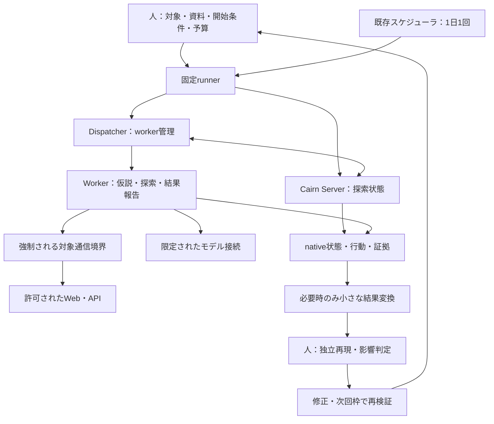

# B案：Cairnによる継続的な脆弱性検知の実行計画

作成日：2026-11-07。状態：計画案。実装・診断・日次運用はすべて未着手。

本書は[導入提案](agentic-security-plan.md)のB案を具体化する下位計画であり、[A案の実行計画](strix-continuous-assessment-plan.md)と同じ段階・粒度で記述する。目的、対象範囲、開始権限、日次頻度、採用基準は導入提案を正とする。ABCDの選択理由は[構成判断記録](assessment-architecture-decisions.md)へ残す。本書の作成はBの採用決定やAからの切替を意味しない。成果物名・インターフェース・工数は実装案であり、利用可能な機能・コマンドの保証ではない。

## 1. 目的と到達点

目的は、AIエージェントを使う攻撃者より早く、自社の脆弱性を検知すること。BではCairnが設計書と外部観測を使って探索し、業務フローの途中状態や権限変更の前後を踏まえた仮説を検証できるかを確かめる。発見から独立再現、修正、次回の再検証までつなげる。

攻撃者の発見時刻は通常観測できないため、優先指標は「外部公開・変更から確認済みfindingまでの時間」とする。時刻が不明なら初回観測を起点と明記する。既存診断やAとの追加検出・確認時間の差を測る。Cairnの探索グラフが成長したことや検出0件を、検査完了や攻撃者より早い検知の証明にはしない。

**最優先は、シンプルなPoCを短時間で動かして実際の結果を得ること。** 最初は既存の起動経路を人が操作し、対象を限定したCairnの探索とnative結果の保存を確かめる。専用runner、結果変換、日次スケジューラは初回起動の前提にしない。対象通信の限定、合成データ、期限、停止方法は初回にも確認する。

| 段階 | 完了条件 | 現在の扱い |
|---|---|---|
| P：初回PoC | Cairnが限定対象を探索し、領域別の結果・未確認箇所・操作順序・証拠を保存。終了と停止を確認 | Bを試す際の最初の到達点 |
| M2：反復と自動化 | 必要なrunner、結果変換、状態復元、異常系、反復評価を追加 | Pの結果から着手範囲を選ぶ |
| M3：日次試行 | 1日1回の探索、状態の引継ぎ、修正再検証を運用 | 手動試行の価値と制御を確認後に進む |
| M4：継続採用判断 | 検知速度・追加検出・費用・人手からB継続、Aとの使い分け、他案を判断 | 日次試行の証拠で判断 |

起動成功、検査範囲、検出の有効性、継続採用は別判定とする。主要領域が未確認なら侵害可能性の評価を完了扱いにしない。欠陥版・修正版の反復や10日次枠の観測は初回PoCの完了条件に含めない。

### 最初に実行する作業：P0〜P4

以下はB案内のP0〜P4であり、他文書から参照するときは「B-P0」のように識別する。全項目未着手。専用host・モデルアクセス・reset可能なfixtureが使える場合、初回結果まで半日〜1日を作業目標とする。全領域の確認と候補の再現に必要な時間は別途見積もる。

| ID | 作業 | 成果物・完了条件 | 目安 |
|---|---|---|---|
| P0 | 対象1つ、許可操作、開始権限、代表モデル、4種類の入力、主要領域、探索の開始条件と達成条件、予算を決定 | 実行メモと領域別確認表。資料版、合成アカウント参照、復元・保存先を記録 | 30分を目安に着手 |
| P1 | Cairnの固定版、worker backendとモデル、起動・project作成・結果取得・停止の経路を確認 | 完全SHA、使用image digest、CLI版、モデルID、確認済み操作手順、未対応一覧 | 1〜2時間 |
| P2 | 専用環境で対象通信、モデル接続、内部制御通信を限定し、停止と残存workerの回収を確認 | 許可対象到達、対象外遮断、dispatcherと全workerの停止証拠。境界が成立しなければ起動を止める | 1〜2時間 |
| P3 | 1 projectで手動起動し、主要領域と状態を持つ業務フローを探索。native結果と探索経過を保存 | 操作の前提・順序・結果、領域別確認表、終了状態、時間・費用・介入 | 対象規模と到達範囲から設定 |
| P4 | 候補を人が初期状態から再現し、未確認領域と残る侵害可能性を整理 | 候補・確認済み・誤判定・未判定、証拠、Bを続ける理由と次の最小作業 | 結果量に応じて設定 |

P0→P1→P2→P3→P4の順とする。完全な台帳や新しい仕様書の整備を待たず、既存資料と短いMarkdownメモで開始する。初回の結果変換は手動でよい。初回を含む診断は合意した1日1回の枠・総予算へ計上する。AとBの比較も許可済みの日次枠へ割り当て、各ツールで枠を追加しない。

P4の結果は構成判断記録へ追記する。Aの未確認箇所を引き継ぐ試行と、Bが独立に探索する試行を区別する。B00〜B12の全実施を前提にせず、初回の障害や追加価値から次の作業を選ぶ。

### 代表的なモデル・入力と状態を持つ探索

利用可能でCairnの固定版backendと接続できるセキュリティ用途のClaudeモデルを第一候補にする。workerを起動するCLIの種類と、実際に推論するモデル提供者・IDを別々に記録する。互換性やアクセス権が不足する場合は、開始前に代替と理由を残す。初回はbackendとモデルを一組に絞り、複数モデルの比較は結果から必要になった場合に行う。

| 入力 | PoCで用意する内容 | agentに期待する使い方 |
|---|---|---|
| 権限表と禁止条件 | 役割・テナントごとの可否、招待・権限変更・退会前後の不変条件 | 正規操作と越権操作を区別し、状態が変わっても境界が保たれるか検査 |
| API仕様と業務フロー | 既存API説明、画面との対応、業務状態、正常な操作の前提 | エンドポイント単体と複数操作の順序から探索仮説を作る |
| 合成データ・アカウント | 未認証、一般利用者、別テナントの初期状態、復元方法 | 同じ操作を異なる役割・状態で比較し、対象の変更を追跡 |
| 検査手順 | WSTG、OWASP API Security Top 10、必要なASVS項目、導入提案のSkill候補から選んだ手順 | 全体の検査領域を計画し、経路ごとの証拠と未確認理由を残す |

手順候補のOWASP Secure Agent PlaybookとAnthropic Cybersecurity Skillsは、導入提案にある参照資料を使う。後者はコミュニティ製である。選択内容・出典・版を記録し、固定版のworkerが読める資料として渡す方法をP1で確認する。全Skillの導入や自動認識を仮定しない。秘密値は承認済みの注入経路で渡し、文書と共有結果へ保存しない。

探索入力はドキュメントと外部観測とし、ソースコード・IaC・既知欠陥の場所や再現手順は渡さない。未認証と通常登録相当の一般権限を基本に、別テナントの合成アカウントを用意する。管理者資格情報は正規操作確認用とし、攻撃探索に使う場合は別シナリオにする。

初回から情報収集・公開設定、認証・セッション、認可・テナント分離、入力・ファイル処理、業務フロー・状態遷移、クライアント側処理を確認表へ並べる。外部連携・公開クラウド資源・AI機能も該当すれば追加する。各領域は「確認して証拠あり／該当なしと根拠あり／未確認と理由・次の検査」で記録する。状態遷移を重視することを理由に他領域を省略しない。

状態を持つフローでは、例えば「招待→参加→役割変更→失効後のアクセス」「ファイル登録→共有→共有解除→再取得」「テナント切替→同一資源への参照」を対象機能に合わせて選ぶ。人は正常な仕様と守るべき条件を渡し、不正な手順の選択はagentに任せる。各段階の主体・テナント・資源・状態・期待結果・実際の結果を残す。業務状態の遷移とCairn内部の探索グラフは別の記録として関連付ける。

検出0件なら探索経路、未確認範囲、認証、停止理由を確認する。モデルや入力の組合せを網羅的に比較することへ時間を使わず、実際にどこまで検証できたかを先に確認する。時間切れの領域は次の許可済み枠へ引き継ぐ。

## 2. 構成と責任分担

公開資料の確認日：2026-11-07。CairnはServer上のFact・Intent・Hintを共有し、Dispatcherがworkerを動かす構成を説明している。Factは探索結果、Intentは次の探索方向、Hintは人の入力として扱われる。local modeはhostのユーザー権限で動作するため、本計画では専用環境を前提にする。これらは公開説明であり、本PJでの動作確認結果ではない。[Cairn README](https://github.com/oritera/Cairn)

公開の設定例には全体・project・worker単位の並列数、task timeout、追加の終了処理時間がある。worker imageは可変タグ、ネットワーク設定はhostモードの例なので、そのまま本PJの制限値として使わない。[dispatch.example.yaml](https://github.com/oritera/Cairn/blob/main/dispatch.example.yaml)

公開ComposeにはServerのポート公開、永続データ、DispatcherへのDocker socketのマウント、自動再起動がある。P1で固定版を確認し、専用host内の配置、到達範囲、停止後の再起動を調整する。workerの隔離と制御系の権限分離を別々に確認する。[docker-compose.yaml](https://github.com/oritera/Cairn/blob/main/docker-compose.yaml)

以下は日次運用へ進む場合の構成。初回は人が起動・停止と証拠保存を行う。図中の結果変換とrunnerは後段の追加候補である。

| 担当 | 責任 | 実行前に確定すること |
|---|---|---|
| AppSec | 検査領域、達成条件、候補の独立確認、日次レビュー、採用判断 | 主担当・不在時担当、重大候補の当日確認方法 |
| 対象開発 | 権限・業務仕様、合成データ、復元、サーバー側証拠、修正 | 対象revision、状態遷移と正常操作、初期化・修正担当 |
| 基盤 | 専用host、モデル接続、資格情報注入、通信制御、保存・停止 | Server・Dispatcher・workerの権限と通信、残存資源の回収方法 |
| Cairn | 許可範囲での仮説生成、探索先の選択、観測による計画変更 | 開始条件と達成条件、入力資料、人によるHintの記録 |
| runner・結果変換 | 起動、排他、期限、状態照合、原証拠を参照する共通記録 | projectとrunの対応、状態変換規則。対象・予算をagentに変更させない |

最小PoCはCairnが必要とする構成、専用環境、ファイル保存とする。独自DB・UI・統括agentは追加しない。Serverの必要な永続状態は保持する。Python・依存・backend CLI・Cairn完全SHA・使用する全image digest・モデルIDはP1で固定する。対象技術は[105項目の台帳](TARGET_TECH_STACK.md)と対応付け、全項目へ一度に対象を広げない。

## 3. PoC後の拡張時に決める事項

初回に必要な値はP0〜P2のメモで確定する。以下は自動化・実対象・日次試行へ進む場合の詳細化項目であり、全項目を初回起動の前提にしない。

| 決定項目 | 必要な情報 | 担当・期限 |
|---|---|---|
| 対象 | 1プロダクト、環境、origin、許可・除外接続先、操作、開始権限 | AppSec・開発／B00 |
| fixture | 合成テナントA/B、欠陥版・修正版、業務状態、正常操作、初期化 | 開発・AppSec／B03 |
| Cairnの実行経路 | CLI/API、project作成・停止・結果取得、backend、モデル利用権限 | 基盤／B01 |
| 制御・外部経路 | Server到達元、Dispatcher管理権限、workerの通信、WAF・認証通常経路 | 基盤／B02、B04、実対象はB09 |
| 資料と状態 | 資料版、goal、projectとrunの対応、状態保存・再開と失効条件 | AppSec・基盤／B01、B07 |
| 費用・上限 | 日次・月間金額、全workerの通信・時間、終了処理も含む集計 | 責任者・基盤／B00、B09 |
| 証拠 | Git外の保存先、アクセス者、保持期間、伏字、モデルへの送信範囲 | AppSec・基盤／B00 |
| 比較条件 | B単独、Aとの独立比較、A候補引継ぎの識別と総予算 | AppSec／B08。引継ぎ試行は価値が見えた場合のみ |
| 日次運用 | 時刻・timezone、結果確認者、欠測・障害の連絡、再起動時の扱い | AppSec・基盤／B10 |

モデルの提供状況・利用権限と固定版backendの互換性は実行前に確認する。候補名やCLIの名称だけでモデル対応を判断しない。

## 4. PoC後の作業候補

全タスクの状態は `NOT STARTED`。P0〜P4の同等証拠があれば再利用し、調査や環境準備を繰り返さない。担当、実際の版、操作、結果、証拠場所を完了時に記録する。工数は作業時間の仮置きであり、外部待ちと日次の観測日数を含まない。

| ID | 作業と成果物 | 依存 | 担当 | 目安 | 完了条件 |
|---|---|---|---|---|---|
| B00 | 実行契約、対象台帳、領域・フロー確認表を作成 | なし | AppSec・開発・基盤 | 0.5〜1日 | 対象、開始状態、許可操作、予算、保存先が識別可能 |
| B01 | 固定版の構成・起動・停止・project操作・認証・出力を調査 | B00 | 基盤・AppSec | 初回0.5日 | capability表、固定版一覧、実際の操作候補、未対応・適用条件が揃う |
| B02 | Server・Dispatcher・workerの通信と権限、独立停止、保存を設計 | B01 | 基盤 | 0.5〜1日 | 制御APIとDocker管理経路を限定し、対象通信の直接迂回を防ぐ方法を決定 |
| B03 | 欠陥版・修正版、合成アカウント、状態遷移ケース、resetを準備 | B00 | 開発・AppSec | 1〜2日 | 人が初期状態から欠陥を再現。修正版で不正操作は拒否、正常操作は成功。正解を分離 |
| B04 | 専用環境と通信制御を用意し固定版を手動試験 | B02、B03 | 基盤・AppSec | 1〜2日 | モデルtool往復、認証維持、結果保存、範囲外遮断、全worker停止を確認 |
| B05 | runnerの入力検証、排他、run IDとproject対応、固定操作、保存を実装 | B04 | 基盤 | 1〜2日 | 不足入力・同時起動を拒否。実Cairnで1回探索しnative出力へ遡れる |
| B06 | deadline、通信停止、dispatcher・worker回収、クラッシュ回復を実装 | B05 | 基盤 | 1〜2日 | 第6節の停止・異常系試験に合格。停止後の再dispatch・対象通信なし |
| B07 | 必要最小限の結果変換、finding、重複、日次要約、状態引継ぎを実装 | B05 | AppSec・基盤 | 1〜2日 | Factと独立確認を区別し、元の証拠へ遡れる。旧revisionの状態を無条件に再利用しない |
| B08 | 固定条件の評価とベースライン比較。欠陥版・修正版を各3回以上resetして評価 | B06、B07 | AppSec・開発 | 準備1日＋日次枠 | 分母・失敗・時間・費用・介入を記録しM2を判定。A未実施なら優劣は未判定 |
| B09 | 自社1プロダクトの外部経路へ接続し資料・操作・復元・予算を確定 | B08 | 全担当 | 1〜2日 | 実対象用契約、通常の認証経路、手動探索と証拠確認が成立 |
| B10 | 既存スケジューラへ接続し日次入力・排他・欠測検知を運用化 | B09 | 基盤・AppSec | 0.5〜1日 | 指定timezoneで1日1枠。非起動・失敗を可視化し、再起動で勝手に再開しない |
| B11 | 10日次枠で探索、トリアージ、修正、再検証を実施 | B10 | AppSec・開発 | 10日次枠＋確認作業 | 全予定枠を報告。0件日も探索・未確認・費用を記録 |
| B12 | B継続、Aとの使い分け、改善、C/D再検討を判断 | B11 | AppSec・責任者 | 0.5〜1日 | 指標の達否・未検証範囲、採用理由、次の改善と再判断条件を記録 |

B01は半日を目安に調査を区切る。必要なモデル・認証・証拠取得・停止が成立せず大幅なエンジン改修が必要なら、障害を記録して構成判断へ戻る。B03とB01〜B02、B07とB06は依存充足後に別作業として進められるが、担当と共有環境の競合を確認して決める。

## 5. 自動化へ進む場合のrunnerと保存データ案

実装は `src/assessment_runner/`、テストは `tests/assessment_runner/`、非秘密のfixture素材は `assets/assessment-fixtures/` を想定する。A用の共通処理が既にあれば再利用し、Cairn固有の起動・状態・結果変換だけを分ける。共通基盤を先に完成させることは求めない。最初のコード追加時にREADME、実際の版、formatter/linterと確認済みコマンドを追加する。未提供の `make setup / test / lint` を利用可能として案内しない。

runnerの候補操作は `preflight`、`run`、`stop`、`summarize`。CairnのCLI/APIはB01で実在を確認して固定する。入力文字列をshell命令として評価しない。期限はbootstrap・reason・explore・終了処理を含む全runへ適用する。task単位のtimeoutやworker数の設定だけで日次の予算上限が成立したとは扱わない。

| 記録 | 必須情報 |
|---|---|
| 実行契約 | schema版、対象・許可操作・revision、開始権限と状態、資料版、goal、ツール・backend・モデル版、時間・通信・費用上限、保存先 |
| run記録 | run ID、project ID、日次枠、UTC開始終了、契約参照、使用版、元のexit code・native状態、実行・診断状態、停止理由、全worker集計と証拠 |
| 探索状態 | Fact・Intent・Hintのnative識別子、生成時刻、親子・参照関係、元の操作・証拠、保存時点。取得不可の情報は不可と記録 |
| 業務フロー | シナリオID、初期状態、主体・テナント・資源、操作順序、各段階の期待／実際、復元証拠、対応する探索記録 |
| finding | finding ID、対象・revision・権限・テナント、前提、伏字通信、再現手順、独立確認、重大度、重複先、担当・期限、修正・再検証 |
| 日次要約 | 変更点、探索、確認済み新規・再検出・候補、未確認と理由、介入、費用、次回の優先候補 |
| 評価記録 | ケースID、評価者のみの正解、反復番号、reset、実行条件、判定、ベースライン差、Aからの情報持込みの有無 |

Cairn内部のFactを自動的に「確認済みfinding」へ変換しない。完了通知も検査全体の完了を意味しない。変換はnative IDと証拠参照を保持し、不足する証拠を生成・補完しない。未知の形式や欠落を成功として読み飛ばさず、原出力を残して未完了にする。

実行状態は `COMPLETED / FAILED / TIMED_OUT / CANCELLED / BLOCKED`、診断状態は `FINDINGS / NO_FINDINGS_REPORTED / INCOMPLETE` とする。認証・モデル障害、出力破損、未確認領域がある場合は `INCOMPLETE` を優先し、得られた候補は保持する。正常終了と未完了は両立する。終了コードとnative状態の意味は固定版で確認する。

初回と独立比較は新しいprojectを基本とし、対象データもresetする。日次も最初は新projectへ確認済み要約を渡す方式とし、同じprojectの直接再開はB07で状態の互換性・失効・残存taskを検証できた場合に選ぶ。旧revisionのFactやセッションを現環境の正解として扱わない。再開時は対象、資料、権限、有効な認証、残予算を再照合し、不一致なら再利用しない。

証拠と状態snapshotはGit外のアクセス制限されたrunディレクトリに保存する。共有要約を伏字処理し、raw証拠の保持は初期案7日、調査中は保持する。削除は所有runを特定した明示操作に限定する。探索グラフも秘密情報を含み得る証拠として扱う。secret-checksはcommit・push時の保護であり、LLM送信と実行時保存の制御は別途必要になる。

## 6. 拡張時の制御と検証条件

初回はP2の通信・停止確認を実施する。以下は自動化・対象拡大時の詳細試験であり、全試験の実装を初回起動条件にしない。初期隔離試験は同時run 1、active project 1、期限15分、停止猶予10秒、毎秒1リクエスト・burst 2、総500リクエスト、同時リクエスト2を仮置きする。workerも初期は1から始め、探索不足の原因として並列数が疑われた場合に総予算を保って変更する。実対象用の値はB09で決める。

通信制御は対象への経路、モデル接続、内部の制御通信を区別して強制する。モデル利用を理由にworkerへ一般インターネット接続を与えない。Serverと管理用socketを外部公開せず、無関係なhost資格情報を渡さない。Dispatcherの管理権限をworkerへ渡さず、専用hostで影響範囲を限定する。HTTPS検証を無効化しない。

| 検証 | 方法・観測点 | 期待結果 |
|---|---|---|
| 入力・排他 | 不足・矛盾入力、2件同時起動、未回収project | 対象通信前に拒否。稼働中runへ影響なし |
| 正常探索 | 固定版でfixtureを探索し、projectとnative証拠を照合 | run・探索記録・対象操作を追跡できる。内部Factと人の判定を区別 |
| 範囲外通信 | shell・browser・workerから直接IP、別host、redirect、名前解決変化 | 境界ログで許可外到達なしを確認。許可対象は利用可能 |
| 制御系境界 | workerと許可されない送信元から管理API・socketへの到達を確認 | 必要な機能以外の管理経路を遮断し、別projectや設定の変更を許さない |
| 流量・時間 | 複数worker、taskの終了処理、上限到達を観測 | 全体の上限で新規探索・対象通信を止める。task timeout後の処理も予算に含む |
| 停止・回復 | timeout、キャンセル、runner/dispatcher強制終了、host再起動 | 停止猶予後の対象通信・再dispatchなし。所有資源を照合し部分証拠を保存 |
| 状態保存・再開 | 保存後停止、対象reset、revision変更、古いセッション | 不一致を検出し旧状態の無条件継続を拒否。再開不可なら新projectで実行 |
| 認証・モデル | 失効、接続障害、拒否、サービス制限 | 未完了と原因を記録。無制限再送・自動提供者切替なし |
| 証拠・変換 | 欠落・破損・未知形式・容量不足、同一findingの重複 | cleanな0件へ変換しない。原証拠へ遡れ、二重計上しない |
| 正解との比較 | 欠陥版・修正版、正常操作、独立した初期状態 | 欠陥の再現と修正版での拒否、正常操作の成功を別々に記録 |
| 指示混入・介入 | 対象応答に指示がある場合と、人のHint追加 | 対象応答で権限・予算が変わらず、人の助言は介入として記録 |
| 日次起動 | 時刻・timezone、前回残存、起動欠測、再起動 | 1日1枠、重複拒否、欠測も確認者が把握。自動埋め合わせなし |

runner単体試験には偽プロセス・固定応答を使えるが、実Cairnの通信、状態、全worker停止の証明とは区別する。停止は新規dispatchの抑止、通信許可の失効、所有workerの回収、証拠保存を含めて確認する。runnerが落ちても期限で失効する通信許可や独立watchdogをB02で選ぶ。

費用は全workerと全モデル呼出しを集計し、providerの課金遅延と制限の実効性を確認する。厳密な金額上限が成立しない場合は明示し、予算責任者が受容した限定試行以外へ広げない。初回の自動再試行は行わず、手動再開も同じ枠・残予算へ計上する。

## 7. 日次の探索・修正・再検証

日次入力は対象・資料の変更、前回の確認済み要約、未探索一覧、修正候補とする。人が最初に範囲と優先候補を確認し、Cairnへ開始条件、権限境界、検査の達成条件を渡す。具体的な探索順序はagentが決める。人の途中のHintや操作支援と、終了後の証拠レビューは別々に計上する。

初期の予算配分案は修正確認20%、変更箇所と重要な権限・状態境界40%、agentが選ぶ未探索経路40%。修正確認がなければ未探索へ回す。B09で割合を確定し、週次に実績を確認する。特定のgoalを早期達成しても領域別確認表を照合し、未確認領域を残す。必要な追加探索は同じ枠の残予算か次の許可済み枠で行う。

AppSecは重大候補を当日確認し、初期状態から操作順序を再現して影響と重複を判定する。担当・期限を付与し、開発が修正したら次回の枠で不正操作の拒否と正常操作の成功を確認する。対象状態の変更やfixtureの破損が原因で再現できない場合は、修正成功とせず復元・再確認する。新規findingがなくてもfixtureの修正例で運用経路を試し、実対象の修正実績と分ける。

予定枠の非起動はrun記録とは別の確認経路で検知する。通知方法・確認担当はB10で確定する。issueや通知の自動作成を初期条件にせず、手動トリアージから開始する。状態snapshotや過去のIntentが残っていても、次の枠の開始判断なしに自動探索を再開しない。

## 8. 評価と採用判断

| 指標 | 計算・記録方法 | 判断への使い方 |
|---|---|---|
| 検知遅延 | 公開／変更→次回枠、探索開始→候補、候補→独立確認を分離 | ベースラインと中央値・最大値・件数を比較 |
| 追加価値 | 同一revision・条件の既存診断やAにない確認済みfinding、または時間・人手改善 | B継続やAとの使い分けの根拠 |
| 評価ケース検出率 | 独立再現できた既知欠陥／対象ケース。拒否・未完了も分母と内訳に残す | 全体80%以上、重大ケース全件を後段の仮目標とする |
| 誤判定 | 確認済みとしたfindingの誤判定率。未判定件数も別掲 | 10%以下を仮目標とし、少数結果には件数を併記 |
| 到達範囲 | API操作×権限×テナント×シナリオの固定分母と完了数 | 重要経路90%以上を仮目標。未確認領域を隠さない |
| 状態を持つ探索 | 初期状態から完遂・再現できた対象フロー数／事前定義したフロー数。失敗箇所も記録 | 単体操作を越えた追加価値を確認。FactやIntent数を検出数に数えない |
| 継続性・再開 | 全予定枠の成功・未完了・欠測・重複拒否、復元・引継ぎの結果 | 日次利用と状態管理の実効性を確認 |
| 自律性 | 助言なしの完遂率、介入回数・時間、応答から探索を変えた実例 | 人のHintで解決したケースを独立探索と区別 |
| 費用 | 全workerのLLM、実行資源、保存、レビュー・復元作業。確定／推計を区別 | 追加検出に見合う負担か判断 |
| 修正接続 | 担当・期限、修正から再検証までの時間と成否 | 放置・回帰を防げるか確認 |

初回は実際の探索・検出・未確認の結果を得ることを優先する。後段の固定条件評価では欠陥版・修正版を各3回以上resetして実行し、知識を引き継ぐ通常運用と分ける。閾値と各分母は評価前に確定する。

Aとの比較では対象revision・資料・権限・データ・時間・費用を揃える。可能ならモデルも揃え、揃わない項目は差として記録してエンジン単体の優劣と断定しない。Bの独立試行にはAのfindingや再現手順を渡さない。Aの候補を引き継ぐ追加試行は別条件とし、AとBの合計費用・時間、候補の出所、追加で確認できたことを記録する。全案比較を初回PoCの前提にしない。

B12では指標をPASS／FAIL／未判定と証拠で示す。制御試験の不合格は対象拡大を止める。検出不足は資料・認証・推論・ツール・状態復元・時間・境界停止に分解する。Bが有効なら継続、Aと異なるフローだけに価値があれば使い分け、追加価値がなければ保留とする。日次のタスク選択負荷はC、証拠管理の負荷はDを再検討する。

判断記録にはBを試した理由、agentへ任せた範囲、実測、推測のまま残る点、採用・継続・保留の理由、次の再判断条件を残す。計画作成だけでADR-001のA優先方針を変更しない。Bの結果を他案や攻撃者の能力上限へ一般化しない。

## 9. 時間計画と再開記録

既存前提が揃えば最初の結果まで半日〜1日を作業目標とする。主要領域の確認と再現の時間は対象規模と未確認範囲から見積もる。P1で大幅な改修が必要と判明したら調査を区切り、長期実装へ自動的に移行しない。

PoC後に全候補を実施する参考見積もりはB00〜B07で約6.5〜12.5人日、以降は反復用の日次枠、実対象接続、10日次枠の観測と確認作業となる。人数・既存基盤が未確定のため納期ではない。導入提案の6週間案に対応させる場合は第1〜2週に準備、第3〜4週に反復と実対象接続、第5週以降に日次観測・判断を置く。Aと同じ日次枠を分けて使う場合や反復が収まらない場合は日程を更新する。

| 日付 | タスク | 状態 | 成果物・証拠 | 未解決事項・次の作業 |
|---|---|---|---|---|
| 2026-11-07 | B案計画書作成、公開README・設定例の確認 | 計画のみ。実行未検証 | 本書、第2節の参照先 | B-P0の対象・予算を決め、B-P1で固定版と接続経路を確認 |

再開時は現在のファイル、固定版、実行記録を照合する。公開mainの参照は調査時点の説明であり固定版の証拠ではない。P1で完全SHAと対応する資料への参照を残す。計画変更は理由と影響する完了条件を記録する。今回の成果は計画書であり、依存導入・実装・診断・スケジューラ設定は未実施。
