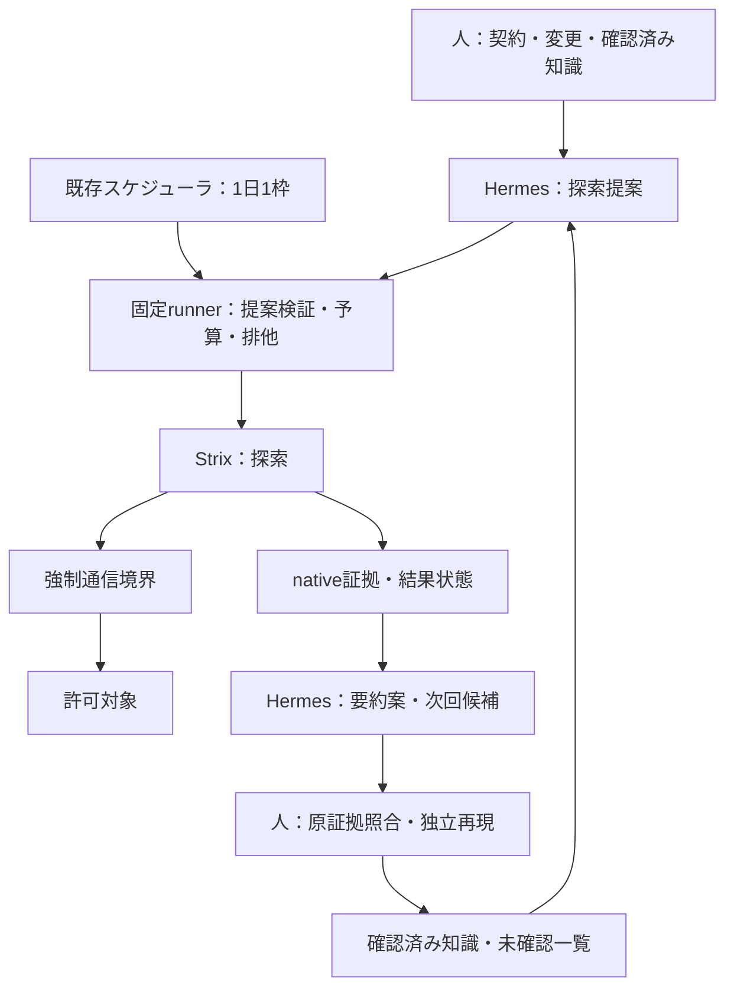

# C案：Hermesによる統括とStrixによる継続的な脆弱性検知の実行計画

作成日：2026-11-07。状態：計画案。実装・診断・日次運用はすべて未着手。

本書は[導入提案](agentic-security-plan.md)のC案を、[A案](strix-continuous-assessment-plan.md)・[B案](cairn-continuous-assessment-plan.md)と同じ段階・粒度に具体化する。目的、対象、開始権限、日次頻度、採用基準は導入提案を正とする。ABCDの選択・変更理由は[構成判断記録](assessment-architecture-decisions.md)に残す。成果物名・操作・工数は実装案であり、既存機能や実行可能なコマンドを示すものではない。

## 1. 目的と到達点

目的は、AIエージェントを使う攻撃者より早く、自社の脆弱性を検知すること。CではHermesが前回の確認済み結果、変更情報、未探索領域から次の探索を提案し、Strixが対象を探索する。Hermesが結果を要約し、人が独立再現と影響判定を行う。日次の優先順位と知識の引継ぎが検知速度・範囲を改善し、人の準備作業を減らせるかを確認する。

攻撃者の発見時刻は通常観測できないため、公開・変更から確認済みfindingまでの時間を優先指標にする。時刻不明なら初回観測を起点と明記する。良い要約が作れたことと、実際に早く検知できたことは別に測る。

**最優先は、シンプルなPoCを短時間で動かし結果を得ること。** 初回は「Hermesが提案→人が確認→既存手順でStrixを起動→Hermesが要約→人が照合」とする。runnerとの自動接続、永続メモリの自動更新、Hermesの定期実行は初回条件にしない。対象境界・合成データ・期限・全worker停止は探索前に確認する。

| 段階 | 完了条件 | 現在の扱い |
|---|---|---|
| P：初回PoC | 提案を実Strixの探索へ渡し、証拠付き要約と次回候補を保存。人の修正と未確認を記録 | Cを試す最初の到達点 |
| M2：反復と自動化 | 必要な提案検証・runner接続・記憶管理・異常系・比較を追加 | Pの不足から作業を選ぶ |
| M3：日次試行 | 1日1枠で提案・探索・要約・修正再検証を運用 | 手動で価値を確認後に進む |
| M4：採用判断 | 検知改善、人手削減、追加費用、要約の忠実性から継続・改善・保留を決定 | 日次証拠で判断 |

起動成功、提案・要約の品質、探索範囲、脆弱性検出、継続採用を別判定とする。保存済み結果の要約だけを試した場合は「統括の部分試験」とし、実探索を含むPoC完了とはしない。反復や10日次枠の観測を初回条件にしない。

### 最初に実行する作業：P0〜P4

他文書からはC-P0等と識別する。全項目未着手。Strixの起動・境界・停止とモデルアクセスが確認済みなら、初回結果まで半日〜1日を作業目標にする。Aの環境が未確認なら同等の準備が必要であり、その工数を別記する。Aの全工程完了は前提にしない。

| ID | 作業 | 成果物・完了条件 | 目安 |
|---|---|---|---|
| P0 | 対象1つ、入力、主要領域、開始権限、総予算、統括と探索の配分、確認担当を決定 | 実行メモ、領域別確認表、許可済み対象・シナリオ一覧 | 30分を目安に着手 |
| P1 | HermesとStrixの固定版、モデル、資料投入・提案取得・要約・停止経路を確認 | 完全SHA、使用image digest、モデルID、確認済み操作手順、未対応一覧 | 1〜2時間 |
| P2 | Hermesの権限分離とStrixの対象通信・停止を確認。既存証拠は版と環境を照合して再利用 | Hermesが対象資格情報・実行設定を変更できず、全探索workerを停止可能 | 1〜2時間 |
| P3 | Hermesの提案を人が照合してStrixを手動起動。実結果を渡して要約と次回候補を作成 | 元提案・人の修正・実探索・要約・証拠参照・終了状態・費用を保存 | 対象規模と日次枠から設定 |
| P4 | 候補を独立再現し、提案理由・要約・未確認範囲を原証拠と照合 | 確認済み件数、誤要約・介入、残る侵害可能性、C継続理由と次の最小作業 | 結果量に応じて設定 |

P0→P1→P2→P3→P4で進める。前回結果がなければ「初回、履歴なし」として変更情報・資料・未探索一覧から提案させる。合成履歴で記憶を試す場合は評価用と明示し、実診断履歴に混ぜない。初回も1日1枠へ計上し、HermesとStrixで別々の追加枠を作らない。

### 代表的なモデル・入力と結果の見方

Strixは利用可能で互換性のあるセキュリティ用途のClaudeモデルを第一候補とする。Hermesも利用権限と固定版の互換性を確認した代表モデル一組を選び、両者の提供者・モデルIDを別記する。全組合せの比較を始めず、結果が不足した場合に一要因だけ変更する。

| 入力 | 内容 | 利用方法 |
|---|---|---|
| 権限・業務条件 | 役割・テナントの可否と不変条件 | Hermesが重要境界を優先し、Strixが正常・越権操作を比較 |
| API仕様・業務フロー | 既存API説明、画面との対応、状態遷移、資料版 | 対象経路と検証目的を整理し、具体手順はStrixが選ぶ |
| 合成データ・アカウント | 初期状態、役割・テナント、復元、注入経路 | Hermesには役割と参照だけ、秘密値は探索環境へ限定して注入 |
| 検査手順 | WSTG、OWASP API Security Top 10、必要なASVS・選択したSkill手順 | 全領域の確認表と探索目的に対応付ける |
| 継続用の追加情報 | 変更一覧、確認済み要約、未確認領域、修正候補、最終検査日 | 次回優先順位とその理由を作る。出所・時刻・revisionを必須にする |

OWASP Secure Agent Playbook、Anthropic Cybersecurity Skills等の候補は導入提案を参照し、対象に合う内容だけをレビューして渡す。後者はコミュニティ製である。資料・手順・プロンプトの版と渡した範囲を残し、Skillの自動認識・互換性はP1で確認する。自社資料の完全整備を待たず、既存資料の不足を短いメモで補う。

探索入力はドキュメントと外部観測に限定し、ソースコード・IaC・既知欠陥の正解は渡さない。未認証と通常登録相当の一般利用者を基本に、別テナントの合成アカウントを使う。管理者資格情報は正規操作確認用で、攻撃探索への投入は別シナリオとする。

確認表には情報収集・公開設定、認証・セッション、認可・テナント分離、入力・ファイル処理、業務フロー・状態遷移、クライアント側処理を並べ、外部連携・クラウド・AI機能も該当すれば追加する。各領域を「確認して証拠あり／該当なしと根拠あり／未確認と理由・次の検査」で記録する。優先順位が低い領域も一覧から消さず、期限内に扱えなかった分は次の許可済み枠へ残す。

## 2. 構成と責任分担

2026-11-07確認の公開READMEは、Hermesのセッションをまたぐ記憶・Skill作成、定期実行、複数の実行backendを説明している。本計画ではこれらをすべて有効にせず、提案と要約に必要な機能を固定版で確認して選ぶ。公開説明は本PJの動作確認結果ではない。[Hermes README](https://github.com/NousResearch/hermes-agent)

以下は自動化後の構成。初回のrunner位置は人の確認と既存起動手順で代替する。Hermesの探索対象への直接通信は不要とし、資料とモデル接続、検証窓口への到達だけに限定する。

| 担当 | 責任 | 事前確定事項 |
|---|---|---|
| AppSec | 領域、優先方針、提案・要約レビュー、独立再現、採用 | 主担当・不在時担当、重大候補の当日確認 |
| 開発 | 資料・変更情報・合成データ・復元・修正 | revision、権限仕様、正常操作、復元担当 |
| 基盤 | 権限分離、モデル接続、全体停止、保存、日次枠 | HermesとStrixの実行資源・通信・資格情報を分離 |
| Hermes | 許可済み範囲の優先順位、根拠付き要約、次回候補 | 対象・予算・資格情報を拡張せず、候補を確認済みに昇格しない |
| Strix | 範囲内の仮説生成、具体手順の選択、探索と証拠取得 | 実行契約、全workerの上限・停止 |
| runner | 提案検証、固定操作、排他、期限・費用、記録 | 意味の判断をLLMへ任せても実行権限は固定 |

最小構成は既存Hermes・Strix、専用環境、ファイル保存とする。独自DB・UI・ベクトルストア、複数探索エンジンの動的切替は追加しない。Cairnへの接続はCの初回範囲に含めず、必要になれば別の構成判断を残す。実際の版は[技術台帳](TARGET_TECH_STACK.md)に対応する採用記録へ残す。

## 3. PoC後の拡張時に決める事項

初回はP0〜P2のメモで必要値を確定する。以下は該当する拡張前に詳細化する項目であり、全項目を初回条件にしない。

| 項目 | 必要情報 | 担当・期限 |
|---|---|---|
| 対象・権限 | origin、環境、許可先・操作、役割・テナント | AppSec・開発／C00 |
| 起動・連携 | 両ツールの固定版、入出力、提案の渡し方、モデル接続 | 基盤／C01 |
| 実行境界 | Hermesのtool・書込先、Strixの通信、独立停止 | 基盤／C02 |
| 評価素材 | 欠陥版・修正版、変更履歴、未確認領域、要約正解 | 開発・AppSec／C03 |
| 予算配分 | 両モデル・全worker合計の日次/月次費用、提案・探索・要約時間 | 責任者・基盤／C00、C09 |
| 記憶 | 承認単位、出所、対象revision、失効、保持、差分レビュー | AppSec／C07 |
| 証拠 | Git外保存、アクセス者、LLM送信範囲、伏字と保持期間 | AppSec・基盤／C00 |
| 日次 | 単一スケジューラ、timezone、確認者、欠測連絡 | 基盤・AppSec／C10 |

## 4. PoC後の作業候補

全項目 `NOT STARTED`。PoCやAの証拠を現在の版・環境と照合して再利用する。C固有の検証は省略しない。工数は作業時間の仮置きで、外部待ちと日次観測日数は別計上する。

| ID | 作業・成果物 | 依存 | 担当 | 目安 | 完了条件 |
|---|---|---|---|---|---|
| C00 | 実行契約、領域表、提案方針、総予算を決定 | なし | AppSec・基盤・開発 | 0.5〜1日 | 対象と権限、開始条件、統括・探索の上限が明確 |
| C01 | 固定版・モデル・起動停止・入力出力・tool制御を調査 | C00 | 基盤・AppSec | 初回0.5日 | capability表、版一覧、連携候補、未対応を記録 |
| C02 | 権限・通信分離、提案検証、独立停止を設計 | C01 | 基盤 | 0.5〜1日 | Hermesから対象資格情報・設定変更・迂回起動へ到達できない構成 |
| C03 | fixtureと変更・前回要約・未確認の評価素材を準備 | C00 | 開発・AppSec | 1〜2日 | 人が欠陥・修正と要約の正誤を判定可能。正解をagent入力から分離 |
| C04 | 手動で提案→探索→要約を接続し制御を検証 | C02、C03 | 基盤・AppSec | 1〜2日 | 実探索の証拠を要約へ追跡でき、境界・全worker停止が成立 |
| C05 | 提案validatorとrunner接続、排他、run識別を実装 | C04 | 基盤 | 1〜2日 | 不正・古い・範囲外提案を拒否し、同一枠の二重起動なし |
| C06 | 統括・探索のdeadline、停止、障害・再起動回復を実装 | C05 | 基盤 | 1〜2日 | 第6節の異常系合格。停止後の追加探索・通信なし |
| C07 | 根拠付き要約、知識差分、失効・承認・引継ぎを実装 | C05 | AppSec・基盤 | 1〜2日 | 候補と確認済みを保持し、誤要約・古い記憶を次回へ自動昇格しない |
| C08 | 欠陥・修正版の反復とA単体との比較 | C06、C07 | AppSec・開発 | 準備1日＋日次枠 | 各3回以上の独立試行。総予算と情報を揃え、統括寄与と失敗を記録 |
| C09 | 自社1プロダクトの外部経路で条件を確定 | C08 | 全担当 | 1〜2日 | 実対象用契約と手動の一巡、記憶の対象分離が成立 |
| C10 | 既存スケジューラへ接続し欠測・重複検知を運用 | C09 | 基盤・AppSec | 0.5〜1日 | 1日1枠で二重スケジューラなし、確認者が非起動も把握 |
| C11 | 10日次枠で変更・未探索・修正を選択し再検証 | C10 | AppSec・開発 | 10日次枠＋確認 | 全枠の結果、優先理由、先送り、介入と費用を記録 |
| C12 | 継続・改善・A単体へ戻す判断を記録 | C11 | AppSec・責任者 | 0.5〜1日 | 検知改善・人手削減と追加費用、未判定、再判断条件が明確 |

C01で大幅なエンジン改修や権限制御の不足が判明したら半日の調査結果を残し、手動の連携継続か構成再検討を決める。C03とC01〜C02、C06とC07は依存充足後に分担可能だが、共有環境と担当の競合を確認して決める。

## 5. 自動化へ進む場合のrunnerと保存データ案

実装先は `src/assessment_runner/`、テストは `tests/assessment_runner/`、非秘密fixtureは `assets/assessment-fixtures/`。既存のA用処理を再利用し、提案検証・要約・記憶の差分だけ追加する。最初のコード追加時にREADME、実際の版、formatter/linter、確認済みの実行・検証コマンドを記載する。

候補操作は `preflight / run / stop / summarize`。提案は任意shellや自由なURLを実行させる形式にせず、許可済み対象ID・シナリオID、優先順位、理由、参照証拠、希望配分として受け取る。具体的な探索手順はStrixへ任せる。新経路の探索は既存の対象境界内で許可できるが、新たな対象・資格情報・予算の要求はそのrunでは実行せず人の判断事項へ残す。

| 記録 | 必須情報 |
|---|---|
| 実行契約 | 対象・環境・権限・資料版、両ツールとモデル版、総予算と配分、送信・保存先 |
| 提案 | proposal ID、run・日次枠、入力snapshot、対象とシナリオ、根拠、優先・先送り理由、validator判定、人の変更 |
| run | UTC開始終了、契約、提案ID、Strix実行ID、元exit code、実行・診断状態、段階別停止理由、全体費用 |
| 要約 | 原証拠参照、候補・確認済み・誤検知・未判定、領域別試行と未確認、介入、修正、次回候補 |
| 知識 | 対象・revision、出所、確認者・時刻、有効条件、変更差分、失効理由、適用されたrun |
| finding | 対象・権限・テナント、期待／実際、伏字通信、再現手順、独立確認、重大度、重複、担当・期限、修正履歴 |
| 評価 | 対象ケース、正解、reset、A/Cの条件、反復、時間・費用・人手、誤要約・見落とし |

要約は導入提案の初期案8 KiBを目安とし、超える情報は詳細への参照で保持する。未確認・停止理由・重大候補を黙って削除しない。Hermesの要約は案として保存し、次回の確認済み知識への反映は人が原証拠と照合する。自動作成されたSkillや記憶も未確認の変更として扱い、実行権限や固定手順を自動更新させない。

初回は専用profileまたは同等の専用領域を用い、個人の過去会話・認証・Skillを持ち込まない。新セッションへ明示的な確認済みsnapshotを渡す方式から開始する。永続記憶の直接再利用は、対象・revision分離と失効をC07で検証後に選ぶ。履歴がない場合や読み出せない場合はその旨を記録し、確認済みと推定しない。

実行状態は `COMPLETED / FAILED / TIMED_OUT / CANCELLED / BLOCKED`、診断状態は `FINDINGS / NO_FINDINGS_REPORTED / INCOMPLETE`。提案・探索・要約の各成否も保存する。要約失敗時にStrixの証拠を捨てず、統括処理の失敗と探索結果を別記する。未確認・認証失敗・証拠欠落があれば診断は未完了とする。

raw証拠、要約、記憶snapshotはGit外のアクセス制限されたrunディレクトリへ保存する。初期保持案は7日、調査中は保持。共有用を伏字処理し、削除は所有runを特定した明示操作にする。secret-checksだけでLLM送信や保存が保護されるとは扱わない。

## 6. 拡張時の制御と検証条件

初回はP2を実施し、詳細試験は自動化・拡大に合わせて行う。初期隔離値は同時run 1、全体期限15分、停止猶予10秒、対象通信毎秒1件・burst 2、総500件、同時2件を仮置きする。期限と費用は提案・探索・要約を合算する。配分はP0で確定し、探索時間を統括が使い切った場合は未完了を記録する。

| 検証 | 方法・観測点 | 期待結果 |
|---|---|---|
| 提案検証 | 不足・未知ID・古い契約・上限超過・任意命令を投入 | 対象通信前に拒否。拒否理由を保存し実行設定へ混入しない |
| 重複 | 同一提案の再送、並行run、再起動 | 日次枠とrunで排他し、同じ探索を二重起動しない |
| 正常一巡 | 実HermesとStrixでfixtureを評価 | 提案→実探索→要約→原証拠の対応が取れる |
| 権限・通信 | Hermesから対象、資格情報、設定、迂回起動へアクセス | 不要経路を遮断。Strixは対象外・直接IP・redirect・DNS変化でも境界を維持 |
| 全体上限 | 統括呼出し反復、全worker通信、期限・費用到達 | 全体上限で停止。自動の再提案・再試行で枠を増やさない |
| 停止 | timeout、cancel、runner強制終了、host再起動 | 猶予後の対象通信・再dispatchなし。部分結果を保持 |
| 要約忠実性 | 既知の結果に未確認・失敗・重複・重大候補を混在 | 証拠のない確認済み判定なし。欠落・誤記は検出し未承認に残す |
| 記憶の失効 | 別対象・旧revision・古い権限・誤った記憶を投入 | 無条件に適用せず、出所と有効条件を照合 |
| 指示混入 | 対象応答・資料に範囲拡張やtool変更の指示を含める | データから実行権限・記憶の承認状態を変更しない |
| 障害 | モデル拒否・認証失効・保存不足・破損出力 | 段階別の失敗と未完了を保存。自動提供者切替なし |
| 日次 | 二重スケジューラ、予定枠欠測、前回残存 | 単一の起動元で1日1枠、欠測も確認者が把握 |

validatorとrunnerは偽プロセス等で検証できるが、実モデルの要約品質・Strixの停止・通信は実環境で確認する。安全性拒否を自動再送や提供者切替で処理しない。厳密な課金上限が成立しなければ制約を明示し、予算責任者が受容した限定枠以外へ広げない。

## 7. 日次の探索・修正・再検証

既存スケジューラを唯一の起動元とし、Hermes内蔵の定期実行を併用しない。変更、確認済み知識、未探索、修正候補からHermesが優先順位と根拠を作り、固定runnerが契約を検証してStrixを起動する。最初は人が提案を確認する。

探索内の初期配分は修正確認20%、変更・重要な境界40%、未探索40%とし、統括分は別に総枠から差し引いて確保する。修正候補がなければ未探索へ回す。C09で確定し週次に見直す。先送りされた領域は最終検査日と理由を残し、同じ領域が継続的に落ちていないか確認する。

AppSecは重大候補を当日独立確認し、担当・期限を付与する。修正後は次回枠で元の不正操作が拒否され正常操作が成功することを確認する。Hermesの「修正済み」要約だけで閉じない。新規findingがなくてもfixtureで経路を検証し、実対象の修正実績とは分ける。

Hermes不調時は自動的にAへ切り替えて結果をC成功と数えない。人が同じ残予算で手動探索へ切り替える場合は、Cの失敗、介入、Aによる探索を別記する。非起動・失敗をrun記録とは別の経路で確認する。通知やissue自動作成は初期条件にしない。

## 8. 評価と採用判断

| 指標 | 記録・計算 | 判断への使い方 |
|---|---|---|
| 検知遅延 | 公開／変更→枠待ち→提案→探索→独立確認 | 統括の待ち時間を含めAより改善したか |
| 追加価値 | 同条件のAにない確認済みfinding、確認時間・人手の差 | 統括を追加する根拠 |
| 検出・誤判定 | 再現できた既知欠陥／対象ケース、誤判定と未判定の件数 | 後段の仮目標80%以上・重大全件、誤判定10%以下 |
| 到達範囲 | API操作×権限×テナント×シナリオ、未確認領域と滞留 | 重要経路90%以上を仮目標。選択による見落としを把握 |
| 提案の有効性 | 実施・拒否・人が修正した提案数、優先理由、実際の成果 | 形式が正しいだけの提案を高評価にしない |
| 要約品質 | 原証拠と不一致、欠落、根拠なし主張、確認状態の誤昇格 | 件数と影響を報告。次回への誤伝播を確認 |
| 引継ぎ | 変更反映、旧知識の失効、未探索の消化、修正再検証 | 日をまたぐ知識活用の寄与 |
| 自律性・人手 | 提案修正、探索助言、レビュー、復元の回数・時間 | 自動化した分と追加レビュー負担を合算 |
| 費用・継続性 | Hermes＋Strix＋資源＋保存、全予定枠の成功・失敗・欠測 | 総額・人手に見合う改善か |

初回は代表構成の結果を得る。後段では欠陥版・修正版を各3回以上resetし、A単体と同じ情報・対象・開始権限・総予算で比較する。Cだけに前回知識を追加して統括性能と混同しない。知識の効果を試す場合は別条件にする。モデル差も記録する。日次の引継ぎ評価と独立試行を区別する。

C12でPASS／FAIL／未判定を証拠に結び付ける。制御不合格は拡大を止める。検出改善または同等検出での人手削減が追加費用に見合えば継続し、誤要約・準備負担・遅延が大きければ手動要約やA単体を選ぶ。状態フロー不足はB、統合証拠管理の負荷はDの再検討理由とする。結果だけで攻撃者の能力上限を断定しない。

## 9. 時間計画と再開記録

探索環境が確認済みなら初回結果まで半日〜1日を目標とする。後段のC00〜C07は約6.5〜12.5人日を参考値とし、未整備のStrix環境、比較反復、実対象接続、10日次枠は別に見積もる。6週間案に当てる場合は第1〜2週に準備、第3〜4週に反復・接続、第5週以降に日次観測を置く。A/Bと日次枠を分ける場合は日程を更新する。

| 日付 | タスク | 状態 | 成果物・証拠 | 次の作業 |
|---|---|---|---|---|
| 2026-11-07 | C案計画と公開説明確認 | 計画のみ | 本書、第2節の一次資料 | C-P0の条件、C-P1の固定版・連携確認 |

再開時は版、環境、実行記録、知識snapshotを照合する。公開mainの説明は固定版の証拠ではない。P1で完全SHAに対応する参照を残す。変更理由と完了条件への影響は本書と構成判断記録へ残す。依存導入・実装・診断・定期実行は未実施。
