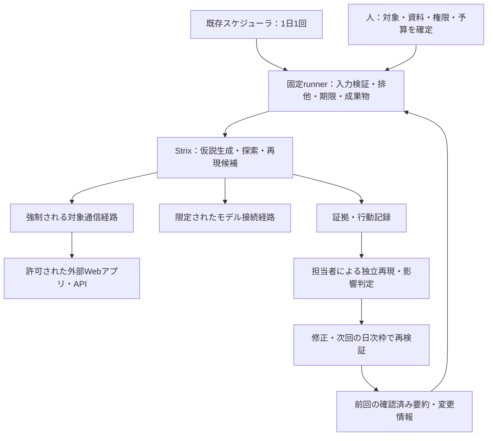

# A案：Strixによる継続的な脆弱性検知の実行計画

作成日：2026-11-07。状態：計画案。以下の実装・診断・日次運用はすべて未着手。

本書は[導入提案](agentic-security-plan.md)のA案を具体化する下位計画である。目的、対象範囲、開始権限、日次頻度、採用基準は導入提案を正とする。B/C/D案の比較方針も同文書に保持する。本書の成果物名・インターフェース・工数は実装案であり、既存機能や利用可能なコマンドを示すものではない。

## 1. 目的と到達点

目的は、AIエージェントを使う攻撃者より早く、自社の脆弱性を検知すること。そのためにStrixを毎日動かし、設計書と外部観測から自律的に探索し、発見した問題を再現・修正・再検証へつなげる。能力の評価は、早期検知と検査範囲の改善に役立てる。

攻撃者の発見時刻は通常観測できないため、優先指標を「外部公開・変更から確認済みfindingまでの時間」とする。公開・変更時刻が不明なら初回観測を起点とし、その制約を表示する。既存診断との比較で追加検出と確認時間の改善を測る。検出0件や隔離環境の成功だけをもって、攻撃者より先に発見できたとは判定しない。

**現在の最優先は、シンプルなPoCを短時間で実際に動かすこと。** 最初は既存CLIを手動起動し、agentが対象へアクセスして探索し、結果を保存できるかを確かめる。専用runnerや定期実行の実装を初回起動の前提にしない。対象を限定する通信境界、合成データ、実行期限、停止方法は初回にも必要だが、既存の隔離環境と機能を優先利用する。

| 段階 | 完了条件 | 現在の扱い |
|---|---|---|
| P：初回PoC | Strixが限定対象を探索し、主要な脆弱性領域ごとの確認結果・未確認箇所・証拠を保存、終了・停止を確認 | 最初にここを進める |
| M2：反復と自動化 | PoCで必要性が判明したrunner・異常系・反復評価を追加 | Pの結果を見て着手範囲を決める |
| M3：日次試行 | 1日1回の継続検知と修正再検証を運用 | 手動実行が役立つことを確認して進む |
| M4：継続採用判断 | 検知速度・追加検出・費用・人手から継続・改善・他案を判断 | 日次試行の証拠で判断 |

PoCの起動成功、検査範囲、脆弱性検出の有効性、継続運用への採用を別々に記録する。探索と出力が完了しても、主要領域が未確認なら侵害可能性の評価を完了扱いにしない。既知欠陥の反復、修正版との比較、10日次枠の観測は初回PoCの完了条件に含めない。

### 最初に実行する作業：P0〜P4

全項目未着手。既存の実行host・モデルアクセス・reset可能なfixtureが使える場合、最初の実行結果まで半日〜1日を作業目標にする。主要領域の確認とfindingの再現に必要な時間は対象規模に応じて決め、短い実行結果だけで検査完了としない。前提不足はその時点で記録する。

| ID | 作業 | 成果物・完了条件 | 目安 |
|---|---|---|---|
| P0 | 対象1つ、許可操作、代表的なモデル、下記4種類の入力、主要な検査領域、時間・費用枠、保存先を決める | 実行メモと領域別の確認表。資料の版と合成アカウントの参照を記録し、秘密値は記載しない | 30分を目安に着手 |
| P1 | Strixの版とimageを固定し、実際のCLI・必要権限・接続経路を確認 | 起動・停止コマンド、完全SHA／digest、モデルID、必要な通信先をメモ | 1〜2時間 |
| P2 | 既存の専用環境で対象・モデル以外への通信制限と停止方法を確認 | 対象到達と対象外遮断、全worker停止の確認。使えない場合は無制限で起動せず構成判断へ戻る | 1〜2時間 |
| P3 | 既存CLIで手動起動し、主要領域を順に探索する。時間切れなら未確認領域を残して次の許可済み枠へ引き継ぐ | native出力、領域別の試行内容・結果、終了状態、所要時間・費用、介入を保存 | 対象の規模と到達範囲から設定 |
| P4 | 領域別の結果を読み、finding候補を人が再現し、残る侵害可能性と次の検査を決める | 発見・確認済み・誤判定・未完了の件数、未確認領域、所要時間・費用、Aを続ける理由または他案を試す理由 | 結果量に応じて設定 |

P0→P1→P2→P3→P4の順に進める。初回は人が操作し、既存機能で不足する箇所だけ短い起動手順で補う。資料は既存のAPI説明・権限説明があれば使い、完全な台帳や仕様書の新規整備を待たない。結果もnative出力と短いMarkdownメモから始める。初回を含む診断は合意した1日1回の枠と予算に計上する。

P4では動作結果を[構成判断記録](assessment-architecture-decisions.md)へ追記する。継続を決めた場合もA00〜A12を全部実施する前提にせず、次に必要な最小タスクを選ぶ。

### 最初のPoCで使う代表的な構成と結果の見方

利用可能でStrixと接続できるセキュリティ用途のClaudeモデルを第一候補とし、自社アプリの既存API仕様・権限表・主要業務フローを入力にする。検査能力の参考には[OWASP Secure Agent Playbook](https://github.com/OWASP/secure-agent-playbook)と[Anthropic Cybersecurity Skills](https://github.com/mukul975/Anthropic-Cybersecurity-Skills)から対象のWeb/APIに該当する手順を選ぶ。後者はAnthropic公式ではないコミュニティ製。両リポジトリの全Skillを取り込むことや、StrixがClaude Code向けSkillを直接実行できることは前提にしない。まず選んだ手順をレビューし、Strixが読める入力として渡す方法をP1で確認する。アクセス権や互換性がないモデルは利用可能なものへ切り替え、理由を記録する。既知欠陥の場所・再現手順はagentに渡さない。

| 入力 | PoCで用意する内容 | agentに期待する使い方 |
|---|---|---|
| 権限表と業務上の禁止条件 | 役割・テナントごとの閲覧、変更、招待、エクスポート等の可否と、守るべき不変条件 | 正規操作と越権操作の期待結果を区別し、境界を検査する |
| API仕様と主要な操作フロー | 既存のOpenAPI等、画面/APIの対応、登録から権限変更・退会までの状態遷移 | エンドポイント単体と複数操作を通した経路の両方を探索する |
| 合成データと複数のテストアカウント | 未認証、一般利用者、別テナント等の開始条件と、復元できるテストデータ | 同じ操作を権限・テナントを変えて試し、結果を比較する |
| 検査の手順 | 対象機能に該当するWSTG、OWASP API Security Top 10、必要に応じてASVSと上記2リポジトリの手順 | 主要な脆弱性領域を抜けなく計画し、各領域の試行・証拠・未確認理由を残す |

既存資料を利用し、不足する項目は短い実行メモで補う。各資料の版とagentへ渡した範囲を記録する。テストアカウントの秘密値は承認済みの注入経路で渡し、文書や報告には保存しない。検査手順は対象と許可操作に合わせて選び、該当しない項目には根拠を残す。

初回から対象に該当する脆弱性領域を広く確認する。最低限、情報収集と公開設定、認証・セッション、認可とテナント分離、入力・ファイル処理、業務フローと状態遷移、クライアント側の処理を確認表に並べる。外部連携、クラウド資源、AI機能など対象固有の入口も加える。各領域は「確認して証拠あり／該当なしと根拠あり／未確認と理由・次の検査」のいずれかで記録する。狭い時間枠で全領域を深掘りできなければ追加の許可済み枠に継続し、検査済みと誤認させない。

この構成で領域ごとに実際に何を試し、何件の候補を出し、何件を人が再現できたかを確認する。検出0件なら試した経路、未確認領域、停止理由を確認する。モデルID、資料とWSTGの版、Skillの有無、実行時間・費用、人の介入を記録する。モデル・資料・Skillの組み合わせを網羅的に比較する代わりに、対象アプリで該当する脆弱性領域を広く扱う。結果が不足し、原因を確かめる必要が生じた場合にだけ、該当する一要因を変えた追加試行を決める。

## 2. 構成と責任分担

以下は日次運用へ進む場合の構成。最初のPoCは「人→既存Strix CLI→限定対象→native結果」の経路を使う。

| 担当 | 責任 | 実行前に確定すること |
|---|---|---|
| AppSec | 検査範囲、評価ケース、finding判定、日次結果確認、採用判断 | 主担当・不在時担当、重大findingの当日確認方法 |
| 対象開発担当 | 資料、合成データ、初期化、サーバー側証拠、修正 | 対象revision、権限仕様、復元方法、修正担当 |
| 基盤担当 | 専用実行環境、通信境界、停止、資格情報注入、日次起動 | 実行host、独立停止機構、費用・保存上限 |
| Strix | 許可範囲内の探索先・仮説・手順の選択 | 人の助言を受けた探索は介入として記録 |
| runner | 検証済みCLI起動、実行状態、境界との連携、記録 | モデルの判断で対象・予算・権限を変更させない |

最小PoCはStrix、専用実行環境、ファイル保存とする。Python runnerと既存スケジューラの接続は、手動試行で必要性を確認した後に追加する。独自DB・UI・統括エージェントは追加しない。実際のPython版、依存、Strixの完全SHA、image digest、モデルIDは調査後に固定する。対象技術は[105項目の台帳](TARGET_TECH_STACK.md)と対応付け、全項目を一度に検査対象へ広げない。

## 3. PoC後の拡張時に決める事項

最初のPoCはP0の実行メモで開始する。以下は自動化・実対象・日次運用へ進む際の詳細化項目であり、すべてを初回起動の前提にはしない。未決定事項は該当する実行の前提条件として管理する。値を推測して実対象を起動しない。

| 決定項目 | 必要な情報 | 決定担当・期限 |
|---|---|---|
| 対象 | 1プロダクト、環境、origin、許可接続先、除外先、許可操作 | AppSec・開発／A00 |
| 初期検証環境 | 合成テナントA/B、欠陥版・修正版、正常操作、初期化 | 開発／A03 |
| 外部経路 | WAF・認証の通常経路、診断元、外部からの到達性 | 基盤・開発／A04、実対象はA09 |
| 資料 | API仕様、設計書、権限表の版。既知の答えは探索入力から分離 | 開発・AppSec／A03、A09 |
| モデル | 提供者・モデルID・接続経路・対象用途の利用条件・実際の利用権限 | AppSec・基盤／A01 |
| 予算 | 1日・月間の金額上限、実行時間、全ワーカーの集計方法 | 責任者・基盤／A00、A09で更新 |
| 日次運用 | 起動時刻、timezone、結果確認者、欠測・失敗時の連絡先 | AppSec・基盤／A10 |
| 証拠 | Git外の保存先、アクセス者、保持期間、伏字処理、LLMへの送信範囲 | AppSec・基盤／A00 |

既存のモデル候補は導入提案第10節を参照する。採用時に提供状況と固定版Strixとの互換性を確認し、候補名だけで対応済みと判断しない。

## 4. PoC後の作業候補

以下はPoC後のバックログであり、初回PoCの必須工程ではない。P0〜P4で得た成果を再利用し、A00〜A04の重複調査・環境準備を繰り返さない。選択した作業では表の依存を満たすか、PoCの同等証拠で充足を記録する。全タスクの状態は `NOT STARTED`。完了時に担当者、実際のrevision、実行コマンド、結果、証拠場所を本書末尾へ記録する。工数は担当者の実作業日で、外部承認・資源待ちと日次の観測日数を含まない仮置き。

| ID | 作業と具体的な成果物 | 依存 | 担当 | 工数目安 | 完了条件 |
|---|---|---|---|---|---|
| A00 | 対象・予算・担当を決定し、実行契約と対象台帳を作成 | なし | AppSec・基盤・開発 | 0.5〜1日 | 初期試験に必要な入力が埋まり、対象と除外先を識別できる |
| A01 | Strixの版を固定。CLI、非対話起動、Docker権限、worker、出力、認証、モデル接続を静的調査 | A00 | 基盤・AppSec | 初回0.5日 | capability表、固定版一覧、実際の起動候補、未対応項目が揃う |
| A02 | A01の構成に合わせ、対象通信・モデル通信・独立停止・証拠保管を設計 | A01 | 基盤 | 0.5〜1日 | 各プロセスの通信権限と停止所有者を図示し、直接接続の迂回を防ぐ方法が決まる |
| A03 | 欠陥版・修正版のfixture、合成アカウント、資料、期待結果、初期化手順を用意 | A00 | 開発・AppSec | 1〜2日 | 人が欠陥を再現でき、修正版では同操作が拒否され正常操作は成功。答えは評価者側だけに保存 |
| A04 | 専用実行環境と通信制御を準備し、固定版Strixの短い手動試験 | A02、A03 | 基盤・AppSec | 1〜2日 | 認証維持、モデルtool往復、証拠出力、worker停止を確認。対象外通信・直接迂回・redirect escapeを拒否 |
| A05 | runnerの入力検証、排他、run ID、固定引数での起動、記録保存を実装 | A04 | 基盤 | 1〜2日 | 偽の子プロセスで欠落入力・同時起動を拒否し、実Strixを1回起動してnative証拠を保持 |
| A06 | deadline、通信遮断、worker回収、クラッシュ回復、結果分類を実装 | A05 | 基盤 | 1〜2日 | 第6節の異常系が合格し、停止後の対象通信が残らない |
| A07 | finding記録、独立再現、重複判定、日次要約、前回情報の引継ぎを実装 | A05 | AppSec・基盤 | 1〜2日 | 原証拠へ遡れ、候補・確認済み・未判定と未完了を区別。秘密値が共有要約へ出ない |
| A08 | 固定条件の評価ケースとベースラインを比較。欠陥版・修正版を各3回以上、resetして実行 | A06、A07 | AppSec・開発 | 準備1日＋日次枠 | 件数・分母・失敗理由・費用・介入・所要時間を報告し、M2を判定 |
| A09 | 自社1プロダクトの外部経路へ適用。資料・認証・操作・副作用・復元・探索予算を確定 | A08 | 全担当 | 1〜2日 | 実対象用契約が揃い、許可経路での手動実行と証拠確認が完了 |
| A10 | 既存スケジューラを同じrunnerへ接続。日次入力・結果確認・欠測検知を運用化 | A09 | 基盤・AppSec | 0.5〜1日 | 指定timezoneで1日1回、重複拒否、非起動・失敗の可視化、再起動時の扱いを確認 |
| A11 | 10回の日次枠で継続検知し、変更検知・トリアージ・修正・次回再検証を実施 | A10 | AppSec・開発 | 10日次枠＋確認作業 | 成功日だけを選ばず全枠を報告。検出0件日も探索・未完了・費用を記録 |
| A12 | 検知速度・追加価値・費用・人手を集計し、A継続・改善・B/C/D再検討を判断 | A11 | AppSec・責任者 | 0.5〜1日 | 各採用条件の達否、残る未検証範囲、次の改善、再判断条件を記録 |

A01で大幅なエンジン改修が必要と分かった場合は、半日の調査結果を残してAの構成を再検討する。A03とA01〜A02、A07とA06は依存が満たされれば別作業として進められる。実装作業の並行化は、担当者と共有環境の競合を確認して決める。

## 5. 自動化へ進む場合のrunnerと保存データ案

実装先は `src/assessment_runner/`、テストは `tests/assessment_runner/`、非秘密のfixture素材は `assets/assessment-fixtures/` を想定する。最初のコード追加時にREADME、formatter/linter設定、実際に利用する版の記録を追加する。`make setup`、`make test`、`make lint` は実装・確認してから利用手順に載せる。ここでは未提供のコマンドを実行手順として扱わない。

runnerの操作は `preflight`、`run`、`stop`、`summarize` を設計候補とする。Strixへの引数はA01で確認して固定し、入力の文字列をshell命令として評価しない。初回は自動再試行を行わず、手動再開も同じ日次枠・予算に計上する。

| 記録 | 必須情報 |
|---|---|
| 実行契約 | schema版、対象origin・許可先・操作、対象revision、資料版、開始権限・アカウント参照、ツール・モデル版、通信・時間・費用上限、保存先 |
| run記録 | run ID、UTC開始終了時刻、日次枠ID、契約の識別子、使用した版、元のexit code、実行・診断状態、stop理由、各種カウンター、費用の確定／推計、証拠参照 |
| finding記録 | finding ID、対象・revision・権限・テナント、期待／実際、伏字通信、再現手順、独立再現結果、重大度、重複先、担当・期限、修正・再検証履歴 |
| 日次要約 | 変更点、今回の探索、確認済み新規・再検出・候補、未検査範囲、介入、未完了理由、費用、次回の優先候補 |
| 評価記録 | ケースID、既知の正解、条件、反復番号、reset証拠、発見・再現結果、ベースラインとの差。探索入力とは分離 |

実行状態は `COMPLETED / FAILED / TIMED_OUT / CANCELLED / BLOCKED`、診断状態は `FINDINGS / NO_FINDINGS_REPORTED / INCOMPLETE` とする。非ゼロ終了の意味は固定版で確認し、finding有りと障害を取り違えない。認証失敗、拒否、破損・欠落出力は未完了とする。runnerが終了記録を書けなかった場合は起動前のrun記録を残し、次回の照合で残存資源を確認して未完了へ確定する。

証拠はGit外のアクセス制限されたrunディレクトリに保存する。共有要約は伏字処理し、raw証拠は初期案として7日保持する。調査中の証拠を保持し、削除は所有runに限定した明示操作とする。既存secret-checksはcommit・push時の保護として利用し、実行中のLLM送信やraw証拠の保護は別途実装する。

## 6. 拡張時の制御と検証条件

初回PoCはP2の対象通信・停止確認を実施する。以下の詳細試験は自動化・対象拡大に合わせて実施し、全試験の実装を初回起動の前提にしない。初期の隔離試験は同時run 1、期限15分、停止猶予10秒、毎秒1リクエスト・burst 2、総500リクエスト、同時リクエスト2を仮置きする。実対象向けの値はA09で決める。1日の時間上限は次の枠をまたがない値とし、内部workerの数に関係なく全体で適用する。

対象通信は必須gatewayまたは同等の強制境界を通す。モデル接続を理由にworkerへ一般インターネット接続を与えない。専用host等でStrixの管理権限を分離し、hostの無関係な資格情報やファイルを渡さない。runner停止後にも失効する通信許可・独立watchdog等の方式をA02で決める。HTTPS検証を無効化して通信制御を成立させない。

| 検証 | 方法・観測点 | 期待結果 |
|---|---|---|
| 入力・排他 | 不足／矛盾入力、2件同時起動 | 対象通信前に拒否。既存runは継続 |
| 正常実行 | 固定版Strixでfixtureを診断 | 元の証拠・終了状態・カウンターが一致 |
| 範囲外アクセス | shell・browser・workerから直接IP、別host、redirect、名前解決変化を試験 | 許可外到達を境界ログで否定。許可対象は利用可能 |
| 流量制限 | 多workerによる並行通信、上限到達 | 対象側の到着数でrate・同時数を確認し、上限後の新規通信を遮断 |
| 停止 | timeout、キャンセル、runner強制終了、worker残存、host再起動 | 停止猶予後に対象通信なし。run所有資源を照合し部分証拠を保持 |
| 認証・モデル障害 | セッション失効、接続失敗、拒否、サービス制限 | 未完了分類と原因を保存。無制限再送・自動提供者切替なし |
| 出力障害 | 出力欠落・破損、保存容量不足 | cleanな検出0件へ分類せず、独立の運用確認経路へ失敗を示す |
| 正解との比較 | 欠陥版・修正版、正常操作、答えを伏せたケース | 欠陥の独立再現、修正版の拒否と正常操作、誤判定を件数で記録 |
| 引継ぎ | 古いrevisionの要約、対象応答からの指示混入 | 古い検査済みを新環境へ転用せず、対象・権限・予算を変更しない |
| 日次起動 | 時刻・timezone、再起動、前回残存、起動欠測 | 1日1枠、重複拒否、欠測も確認者が把握。自動の埋め合わせ起動なし |

runner単体試験は偽プロセスで行い、実Strixの挙動を証明したとは扱わない。境界・worker停止・証拠形式は実Strixで別途確認する。費用は全workerを含め、provider側の課金遅延と強制停止可能性を確認する。厳密な金額上限が実現できない場合は明示し、予算責任者が受容した限定試行以外へ拡張しない。

## 7. 日次の探索・修正・再検証

日次枠の入力を、対象・資料の変更、前回の確認済み要約、未探索一覧、修正済み候補から作る。最初は人が要約と優先候補を確認する。agentには資産・期待する権限境界・成功条件を渡し、探索の具体手順は選ばせる。探索中の人の助言と、終了後の証拠レビューを分けて計上する。

予算配分の初期案は、修正確認20%、変更箇所と重要な権限境界40%、agentが選ぶ未探索経路40%とする。修正確認がない日はその枠を未探索へ回す。割合はA09で確定し、週次に実績で見直す。緊急対応で配分を変えた日は変更理由と未実施範囲を残す。日次回数を増やして予算を迂回しない。

AppSecは新規findingを独立再現して影響と重複を判断し、重大候補は当日確認する。開発担当が修正し、次回の日次枠で元の再現操作が失敗し、正常操作が成功することを確認する。新規findingがない期間でも、fixture上の修正例を使ってこの運用経路を検証し、実対象での修正実績とは分ける。

run起動・終了の記録とは別に、予定枠が実行されなかったことを検出する運用確認を用意する。通知方法・連絡先はA10までに確定する。通知やissueの自動作成は最初から組み込まず、確認者の手動トリアージで開始できる。

## 8. 評価と採用判断

| 指標 | 計算・記録方法 | 判断への使い方 |
|---|---|---|
| 検知遅延 | 公開／変更→次回枠までの待ち、探索開始→候補、候補→独立確認を別々に計測 | 既存診断と中央値・最大値・件数を比較し、遅延箇所を改善 |
| 追加価値 | 同一revision・条件のベースラインにない確認済みfinding、または同等検出での時間・人手改善 | A継続の主要根拠 |
| 評価ケース検出率 | 再現できた既知欠陥／対象ケース。拒否・未完了も分母と内訳に残す | 導入提案の全体80%以上、重大ケース全件を仮目標として判定 |
| 誤判定 | 確認済みとしたfindingの誤判定率、未判定件数を別掲 | 仮目標10%以下。少数なら件数を併記 |
| 到達範囲 | API操作×権限×テナント×シナリオの固定分母と完了件数 | 重要経路90%以上を仮目標とし、未検査領域を隠さない |
| 継続性 | 予定日次枠、実行・未完了・欠測・重複拒否の件数 | 成功日のみで評価しない |
| 自律性 | 助言なしの完遂率、介入回数・時間、適応・連鎖の実例 | 検知改善に必要な情報・モデル・予算を選ぶ |
| 費用 | 全workerのLLM、実行資源、保存、人手。確定値と推計を区別 | 日次・月次予算内か、追加成果に見合うか |
| 修正接続 | 担当・期限の付与、修正→次回再検証の時間と結果 | 検出後の放置と回帰を防ぐ |

欠陥版・修正版で各3回以上の反復を行い、resetした独立試行と、知識を引き継ぐ通常運用を別条件にする。反復は日次枠に割り当てる。モデル・資料・予算を比較するときは一要因ずつ変更し、同一枠内で複数ケースを扱う場合も総予算を固定する。

A12では各指標をPASS／FAIL／未判定として証拠と紐付ける。制御試験の不合格は対象拡大を止める。検出力が不足する場合は情報不足・認証・推論・ツール・予算・境界による停止を切り分ける。状態を持つフローの不足はB、日次タスク選択の負荷はC、証拠管理の自作負荷はDの比較を再検討する。Aの結果だけで他の構成や攻撃者の能力上限を断定しない。

## 9. 時間計画と再開記録

最初の実行結果までは半日〜1日を作業目標とし、PoCの領域別確認と再現に要する時間は対象規模と未確認箇所で見積もる。以下はPoC後に全候補を実施する場合の参考見積もりであり、初回PoCの工数ではない。A00〜A07が約6.5〜12.5人日、以降は評価ケース数に応じた日次反復、実対象への接続、10日次枠の観測が必要。人数・対象・既存基盤が未確定のため納期ではない。導入提案の6週間案に対し、第1〜2週を準備、第3〜4週を反復と実対象接続、第5週以降を日次観測・採用判断の目安とする。10日次枠や比較ケースが収まらなければ、観測を省略せず日程を更新する。

| 日付 | タスク | 状態 | 成果物・証拠 | 未解決事項・次の作業 |
|---|---|---|---|---|
| 2026-11-07 | 計画書作成 | 計画のみ | 本書 | P0の対象・予算・モデル接続を決め、P1〜P4で最初の結果を得る |

再開時はこの表だけで完了扱いにせず、現在のファイル、固定版、実行記録を照合する。計画変更は理由と影響する合格条件を記録する。今回の成果は計画書であり、依存導入・実装・診断・スケジューラ設定は未実施。
